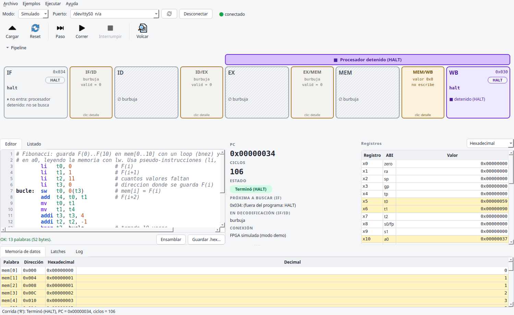

# Lab 3 - Trabajo Final: Pipeline RISC-V + Debug Unit

Procesador **RISC-V (RV32I)** segmentado en 5 etapas (IF, ID, EX, MEM, WB),
con forwarding, stall por load-use y flush en los saltos, implementado en la
Basys 3 a **62,5 MHz**. Una **Debug Unit** permite controlarlo desde la PC por
UART (115200 baudios, 8N1): cargar un programa, correrlo, avanzar de a un
ciclo, interrumpirlo y leer los registros, los latches del pipeline y la
memoria de datos. Del lado de la PC hay un **depurador gráfico** en Python
(PySide6).

- Consigna: [`TRABAJO-FINAL-2026.pdf`](TRABAJO-FINAL-2026.pdf)
- Informe: [`docs/informe/output/Lab3-Pipeline.pdf`](docs/informe/output/Lab3-Pipeline.pdf)

`top` = `reset_gen` + `uart` + `intf` + `debug_unit` (`control_fsmd` + `dump_mux`) + `cpu`,
con el reloj generado por `clk_wiz_0`.

| Comando | Qué hace |
|---|---|
| `'L'` | Carga un programa en la memoria de instrucciones |
| `'X'` | Resetea solo el procesador (responde `'K'`) |
| `'R'` | Corre hasta HALT, error o `'I'`, y manda el volcado |
| `'S'` | Avanza un ciclo y manda el volcado |
| `'D'` | Manda el volcado (326 bytes: estado, PC, ciclos, registros, latches y memoria) |
| `'I'` | Interrumpe una corrida |

El contrato entre cpu y debug_unit, y el formato del volcado, están en
[`src/params.vh`](src/params.vh).

**Depurador gráfico (parte C):** `bash scripts/gui/lanzar_depurador.sh`, o
"Depurador TP RISC-V" en el menú del sistema. Funciona con la placa o en modo
simulado, sin placa. Incluye una **vista del pipeline**: qué instrucción hay en
cada etapa y cuándo hay forwarding, stall o flush
([cómo leerla](docs/manual_depurador.md#vista-del-pipeline)).
Instalación y uso: [`docs/manual_depurador.md`](docs/manual_depurador.md).



Diagramas: [sistema completo](docs/informe/img/sistema_completo.png),
[pipeline del cpu](docs/informe/img/CPU_completo.png),
[debug unit](docs/informe/img/B_completo.png) y
[máquina de estados](docs/informe/img/debug_unit_fsm.png). Los dos primeros se
generan con `docs/informe/img/fuentes/diagramas.py`.

## Documentación

| Documento | Contenido |
|---|---|
| [`docs/decisiones_de_diseno.md`](docs/decisiones_de_diseno.md) | Decisiones de diseño (cpu, debug unit, integración, depurador, reloj) y respuestas a las preguntas de la consigna |
| [`docs/instrucciones_cpu.md`](docs/instrucciones_cpu.md) | Instrucciones soportadas, con ejemplos |
| [`docs/manual_depurador.md`](docs/manual_depurador.md) | Instalación y uso del depurador gráfico |
| [`docs/CHECKLIST_placa.md`](docs/CHECKLIST_placa.md) | Pruebas en la placa con los valores esperados y cómo leer los LEDs |
| [`docs/estudio_defensa.md`](docs/estudio_defensa.md) | Material de estudio para la defensa, con el [guion de presentación](docs/estudio_defensa.md#4-guion-de-presentación-3-a-5-minutos) |
| [`docs/informe/`](docs/informe/) | Informe en LaTeX (`Lab3-Pipeline.tex`), figuras y PDF compilado |

---

## Estructura

```
src/                    fuentes de diseño (Design Sources en Vivado)
  params.vh             CONTRATO: anchos, interfaz cpu <-> debug_unit, campos de
                        los latches, protocolo (solo documentación: ningún módulo
                        lo incluye; NO agregarlo a Vivado como fuente)
  ip/
    clk_wiz_0.xci       Clocking Wizard (MMCM): 100 MHz del pin -> 62,5 MHz para
                        todo el diseño, con salida locked (solo Vivado)
  debug_unit/
    top.v               módulo superior: pines de la Basys 3.
                        Parámetro USE_CPU_STUB: 0 = cpu real (placa), 1 = cpu_stub
                        Parámetro USE_CLK_WIZ: 1 = clk_wiz (placa), 0 = clk = i_clk
                        (simulación). CLK_FREQ = 62,5 MHz (= salida del clk_wiz)
    reset_gen.v         reset global: encendido + botón + locked
    uart.v              wrapper: baud_rate_generator + rx_fsmd + tx_fsmd
    intf.v              wrapper: rx_intf + tx_intf
    debug_unit.v        wrapper: control_fsmd + dump_mux
      control_fsmd.v    FSM + registros (protocolo): 'L', 'X', 'D', 'S', 'R' e 'I'
      dump_mux.v        combinacional: índice del volcado -> byte (326 bytes)
    cpu_stub.v          procesador falso con los puertos del contrato (solo tb_top)
  cpu/
    cpu.v               cpu completo: IF, ID, EX, MEM, WB + forwarding, stall, flush
    if/                 pc_reg, instr_mem
    id/                 control_unit, imm_gen, reg_file
    ex/                 alu, alu_control
    mem/                data_mem
    pipeline/           latches if_id, id_ex, ex_mem, mem_wb
    hazards/            forwarding_unit, hazard_unit
    cpu_if_id_test.v    prueba aislada de IF/ID (no se usa en el top)

testbench/              testbenches (Simulation Sources en Vivado)
  tb_top_cpu.v          top con el cpu REAL por UART, contra el modelo (integración)
  tb_cpu_isa.v          cpu solo, contra el contrato y contra el modelo, ciclo a ciclo
  tb_top.v              protocolo de la debug_unit con el cpu_stub (USE_CPU_STUB = 1)
  tb_dump_mux.v         dump_mux solo: los 326 bytes del volcado
  tb_cpu_stub.v         cpu_stub solo
  tb_cpu.v, tb_*.v      testbenches de la parte A (módulos del cpu; -g2012)
  vectores/             generado por rv32i_model.py --generar (no editar)

constrains/
  top.xdc               pines de la Basys 3 (clock, botón, UART, 8 LEDs)

scripts/
  ensamblador.py        ensamblador mínimo RV32I: .asm -> .hex
  rv32i_model.py        modelo de referencia: valores esperados y vectores de prueba
  uart_test.py          prueba desde la PC (pyserial): echo, x, l, d, s, r, step, terminal
  run_all_tests.sh      corre todas las pruebas y muestra un resumen
  run_cpu_tests.sh      testbenches de la parte A
  mutaciones.py         pruebas de mutación (rompe el diseño y verifica que un test falle)
  programas/            programas de prueba: .asm (fuente) y .hex (generado, con el
                        resultado esperado en la cabecera)
    defensa/            demos de la defensa (en la GUI: Ejemplos → Defensa)
  gui/                  DEPURADOR GRÁFICO (parte C)
    depurador.py        punto de entrada
    app/                ventana, editor, tablas, vista de latches y del pipeline, tema
    protocolo.py        comandos de la Debug Unit y lectura del volcado
    transporte.py       puerto serie real (pyserial)
    fpga_simulada.py    placa simulada, para usar la GUI sin hardware
    hilo_serie.py       comunicación en un hilo aparte
    decodificador.py, desensamblador.py, campos_latches.py
    pipeline_sim.py     simulador ciclo a ciclo del cpu, copia del RTL
    pipeline_view.py    qué instrucción hay en cada etapa y qué está pasando
    programas/          ejemplos de la GUI (menú Ejemplos)
    generar_programas.py  ensambla y verifica los ejemplos de la GUI
    capturas.py, capturas_defensa.py   generan las capturas del informe y el manual
    tests/              pruebas en pytest (y tests/hdl/: testbenches para contrastar con el RTL)
    requirements.txt    PySide6, pyserial, pytest, pytest-qt
    lanzar_depurador.sh, instalar_lanzador.sh, depurador.desktop, correr_tests.sh

docs/
  decisiones_de_diseno.md, instrucciones_cpu.md, manual_depurador.md,
  CHECKLIST_placa.md, estudio_defensa.md
  informe/
    Lab3-Pipeline.tex   fuente del informe
    output/             PDF compilado (lo único que se versiona de esta carpeta)
    img/                figuras: diagramas (.svg y .png), capturas del depurador
                        y de Vivado
      fuentes/          diagramas.py y svgdiag.py: generan los diagramas
    logos/              logos para la carátula
```

## En Vivado

El proyecto de Vivado no se versiona: hay que crear uno nuevo y agregar:

- *Design Sources*: todos los `src/debug_unit/*.v` y `src/cpu/**/*.v`
  (incluido `cpu_stub.v`: el `generate` lo nombra aunque no lo use).
  `cpu_if_id_test.v` es opcional. **No** agregar `src/params.vh`.
- IP: `src/ip/clk_wiz_0.xci` (*Add Sources → Add or create design sources*) y
  después *Generate Output Products*. Genera los 62,5 MHz de todo el diseño
  (M = 10, D = 1, O = 16).
- *Simulation Sources*: los `testbench/*.v`. Los testbenches que leen
  vectores buscan `testbench/vectores/` relativo a la carpeta donde corre la
  simulación; en Vivado conviene pasar la ruta absoluta con
  `-testplusarg VEC=/ruta/a/Lab3/testbench/vectores/`.
- Constraints: `constrains/top.xdc`. Módulo superior de síntesis: **`top`**
  (con `USE_CPU_STUB = 0` y `USE_CLK_WIZ = 1`, los valores por defecto).
  El xdc **no** tiene `create_clock` (está comentado): el clock de 10 ns del
  pin lo declara el propio IP `clk_wiz_0`, y Vivado deriva de él el clock de
  62,5 MHz. Redeclararlo con `-add` duplica los clocks (TIMING-6 y TIMING-56
  en `report_methodology`); sin `-add` pisa el del IP (Constraints 18-1055).
  Solo hay que descomentarlo si se sintetiza con `USE_CLK_WIZ = 0`.
- Icarus Verilog no simula el IP de Xilinx: todo lo que instancia `top` en
  simulación pasa `USE_CLK_WIZ = 0` y `CLK_FREQ = 100_000_000` (clock de 10 ns).

## Simular

Hace falta Icarus Verilog y Python 3.

**Todo de una vez**, desde cualquier carpeta:

```
bash scripts/run_all_tests.sh            # todo (tb_top y tb_top_cpu son lentos)
bash scripts/run_all_tests.sh --rapido   # sin tb_top y con tb_top_cpu +RAPIDO
python3 scripts/mutaciones.py            # pruebas de mutación (varios minutos)
bash scripts/gui/correr_tests.sh         # tests de Python del depurador
```

**Uno por uno**, desde `Laboratories/Lab3`:

```
python3 scripts/rv32i_model.py --generar        # .hex y vectores (antes de los tb)
iverilog -Wall -g2005 -o isa.vvp testbench/tb_cpu_isa.v src/cpu/*.v src/cpu/*/*.v && vvp -n isa.vvp
iverilog -Wall -g2005 -o tc.vvp  testbench/tb_top_cpu.v src/debug_unit/*.v src/cpu/*.v src/cpu/*/*.v && vvp -n tc.vvp
iverilog -Wall -g2005 -o tb.vvp  testbench/tb_top.v src/debug_unit/*.v src/cpu/*.v src/cpu/*/*.v && vvp -n tb.vvp
iverilog -Wall -g2005 -o dm.vvp  testbench/tb_dump_mux.v src/debug_unit/dump_mux.v && vvp -n dm.vvp
iverilog -Wall -g2005 -o st.vvp  testbench/tb_cpu_stub.v src/debug_unit/cpu_stub.v && vvp -n st.vvp
bash scripts/run_cpu_tests.sh                    # parte A
```

Los `.vvp` que quedan en la carpeta están ignorados por git.

Resultados esperados:

```
PASS: cpu cumple el contrato (partes A y B, 11 programas)
PASS: top con el cpu real (11 programas por UART)
PASS: comandos 'L', 'X', 'D', 'S', 'R' e 'I' correctos
PASS: dump_mux arma los 326 bytes en orden
PASS: cpu_stub cumple el contrato
```

Los testbenches de la parte B corren a **1 Mbaud solo en simulación**; el
diseño sigue en 115200.

## Programas

Se escriben en ensamblador (`scripts/programas/*.asm`) y se traducen con
`scripts/ensamblador.py`:

```
python3 scripts/ensamblador.py scripts/programas/saltos.asm      # -> saltos.hex
python3 scripts/rv32i_model.py scripts/programas/saltos.asm      # resultado esperado
```

`rv32i_model.py --generar` regenera todos los `.hex` (con el resultado
esperado en la cabecera) y verifica las líneas `# ESPERADO:` de cada `.asm`.

La memoria de datos es RAM y **no se borra** con el reset ni con `'L'`:
conserva lo que dejó el programa anterior. Cada programa tiene que
inicializar con `sw` los datos que usa; `--generar` da error si un programa
lee (o escribe a medias) una palabra que no inicializó.

| Programa | Qué prueba | Resultado esperado (estado, ciclos, PC) |
|---|---|---|
| `ejemplo_3` | dos addi encadenados | 0x01, 6, 0x0C — x1 = 5, x2 = 8 |
| `nops_5` | latencia del HALT | 0x01, 9, 0x18 |
| `sumas_encadenadas` | forwarding EX/MEM y MEM/WB, bypass WB→ID, x0 | 0x01, 18, 0x3C — x10 = 0xFFFFFFEC |
| `alu` | todas las operaciones, casos borde | 0x01, 36, 0x84 |
| `memoria` | sb/sh/sw + lb/lh/lw/lbu/lhu, load-use | 0x01, 34, 0x74 — mem[0] = 0x01237AFF |
| `saltos` | beq/bne tomado y no, jal/jalr, flush | 0x01, 28, 0x58 — x7 = 0x4C |
| `loop_bne` | loop de 10 vueltas, sw/lw, load-use en beq | 0x01, 63, 0x30 — x2 = 55 |
| `NOPx256` | memoria de programa llena: 255 NOPs y HALT en la palabra 255 | 0x01, 259, 0x400 |
| `error_ilegal` | instrucción ilegal | **0x05**, 5, 0x08 |
| `error_lw` | lw fuera de la memoria de datos | **0x05**, 6, 0x14 |
| `loop_infinito` | `j .` sin fin | cortar con `'I'` → **0x02** |

Las demos de la defensa están en `scripts/programas/defensa/` y los ejemplos
del depurador en `scripts/gui/programas/`. No entran en los vectores de
integración; los verifican los tests de Python del depurador.

## Probar en la placa (Linux)

Ver **[`docs/CHECKLIST_placa.md`](docs/CHECKLIST_placa.md)** (valores esperados
con el cpu real). Los LEDs LD0–LD3 muestran el estado de la Debug Unit y LD4
se prende cuando el procesador está detenido (HALT o error).

```
python3 scripts/uart_test.py --list
python3 scripts/uart_test.py /dev/ttyUSB1 x
python3 scripts/uart_test.py /dev/ttyUSB1 l scripts/programas/saltos.hex   # o el .asm
python3 scripts/uart_test.py /dev/ttyUSB1 r          # corre; Enter = interrumpir ('I')
python3 scripts/uart_test.py /dev/ttyUSB1 d          # volcado (--raw: también en hex)
python3 scripts/uart_test.py /dev/ttyUSB1 step       # interactivo: Enter = paso, d, x, q
```

El modo `d` muestra cada latch con sus campos con nombre (`IF/ID pc=… instr=…`)
y el estado como `halted / interrumpido / error`.

Si aparece "Permission denied": `sudo usermod -aG dialout $USER` y volver a
iniciar sesión.

## Estado

Terminado y probado en la placa a **62,5 MHz** (ver
[`docs/CHECKLIST_placa.md`](docs/CHECKLIST_placa.md)). Todas las pruebas de
simulación dan `PASS`.

- Timing: WNS = +0,802 ns, WHS = +0,051 ns. A 100 MHz sin `clk_wiz` daba
  WNS = −3,111 ns.
- Recursos: 2449 LUT (11,8 %) y 1629 flip-flops (3,9 %). Las dos memorias
  salen como **RAM distribuida** (208 LUT como memoria, 0 Block RAM).

El detalle está en el informe y en la sección 12 de
[`docs/decisiones_de_diseno.md`](docs/decisiones_de_diseno.md).

Pendientes:
- Revisar en Vivado que la síntesis no tenga warnings críticos (multi-driven,
  latches, timing loops ni "RAM implemented as registers").
- Funciones extra que no se implementaron: display de 7 segmentos y, en el
  depurador, comparación con el modelo, diagrama de ciclos, historial y
  exportación.
- `params.vh` documenta el contrato, pero las constantes del RTL todavía no
  se centralizan ahí.
