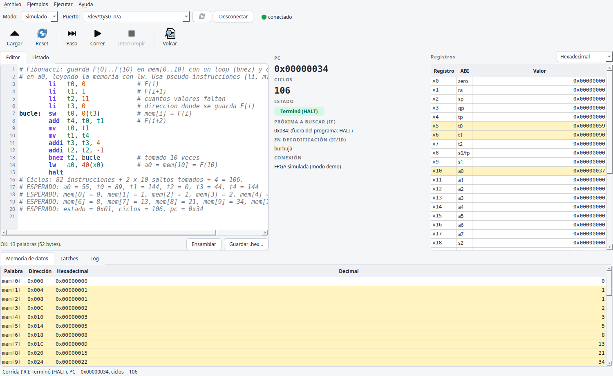

# Trabajo Final — Pipeline RISC-V + Debug Unit (Lab3)

**Estado: paso 4. El cpu real (pipeline de 5 etapas) está integrado con la
Debug Unit; protocolo completo: `'L'`, `'X'`, `'D'`, `'S'`, `'R'` e `'I'`.**

`top` = `reset_gen` + `uart` + `intf` + `debug_unit` (`control_fsmd` + `dump_mux`) + `cpu`.

Todas las pruebas dan `PASS` en simulación (`bash scripts/run_all_tests.sh`).
Falta validar en Vivado (timing y recursos) y en la placa: `CHECKLIST_placa.md`.

**Depurador gráfico (parte C):** `bash scripts/gui/lanzar_depurador.sh`, o
"Depurador TP RISC-V" en el menú. Funciona con la placa o en modo simulado.
Instalación y uso: [`docs/manual_depurador.md`](docs/manual_depurador.md).



Decisiones de diseño (cpu, debug unit, integración, depurador y respuestas a
las preguntas de la consigna): [`docs/decisiones_de_diseno.md`](docs/decisiones_de_diseno.md).

**Defensa:** documento de estudio en [`docs/estudio_defensa.md`](docs/estudio_defensa.md).
Diagramas: [sistema completo](docs/img/sistema_completo.png),
[pipeline del cpu](docs/img/CPU_completo.png), [debug unit](docs/img/B_completo.png) y
[máquina de estados](docs/img/debug_unit_fsm.png) (los dos primeros se generan con
`docs/img/fuentes/diagramas.py`).
Contrato entre cpu y debug_unit, y formato del volcado: [`src/params.vh`](src/params.vh).

---

## Estructura

```
src/                    fuentes de diseño (Design Sources en Vivado)
  params.vh             CONTRATO: anchos, interfaz cpu <-> debug_unit, campos de
                        los latches, protocolo (solo documentación: ningún módulo
                        lo incluye; NO agregarlo a Vivado como fuente)
  debug_unit/
    top.v               módulo superior: pines de la Basys 3.
                        Parámetro USE_CPU_STUB: 0 = cpu real (placa), 1 = cpu_stub
    reset_gen.v         reset global: encendido + botón + locked
    uart.v              wrapper: baud_rate_generator + rx_fsmd + tx_fsmd
    intf.v              wrapper: rx_intf + tx_intf
    debug_unit.v        wrapper: control_fsmd + dump_mux
      control_fsmd.v    FSM + registros (protocolo): 'L', 'X', 'D', 'S', 'R' e 'I'
      dump_mux.v        combinacional: índice del volcado -> byte (326 bytes)
    cpu_stub.v          procesador falso con los puertos del contrato (solo tb_top)
  cpu/
    cpu.v               cpu completo: IF, ID, EX, MEM, WB + forwarding, stall, flush
    if/ id/ ex/ mem/ pipeline/ hazards/   módulos del cpu
    cpu_if_id_test.v    prueba aislada de IF/ID (no se usa en el top)

testbench/              testbenches (Simulation Sources en Vivado)
  tb_top_cpu.v          top con el cpu REAL por UART, contra el modelo (integración)
  tb_cpu_isa.v          cpu solo, contra el contrato y contra el modelo, ciclo a ciclo
  tb_top.v              protocolo de la debug_unit con el cpu_stub (USE_CPU_STUB = 1)
  tb_dump_mux.v         dump_mux solo: los 326 bytes del volcado
  tb_cpu_stub.v         cpu_stub solo
  tb_cpu.v, tb_*.v      testbenches de la parte A (módulos del cpu; -g2012)
  vectores/             generado por rv32i_model.py --generar (no editar)

constrains/
  top.xdc               pines de la Basys 3 (clock, botón, UART, 8 LEDs)

scripts/
  gui/                  DEPURADOR GRAFICO (parte C): depurador.py, protocolo.py,
                        decodificador.py, desensamblador.py, fpga_simulada.py,
                        hilo_serie.py, app/ (ventana), programas/ (demos),
                        tests/ (pytest), lanzar_depurador.sh, instalar_lanzador.sh
  uart_test.py          prueba desde la PC (pyserial): echo, x, l, d, s, r, step, terminal
  ensamblador.py        ensamblador mínimo RV32I: .asm -> .hex
  rv32i_model.py        modelo de referencia: valores esperados y vectores de prueba
  run_all_tests.sh      corre todas las pruebas y muestra un resumen
  mutaciones.py         pruebas de mutación (rompe el diseño y verifica que un test falle)
  run_cpu_tests.sh      testbenches de la parte A
  programas/            programas de ejemplo: .asm (fuente) y .hex (generado, con el
                        resultado esperado en la cabecera)

docs/
  decisiones_de_diseno.md   decisiones (cpu, debug unit, integración) e historial
  instrucciones_cpu.md      instrucciones soportadas, con ejemplos
  img/                      diagramas del apartado B (B_completo, debug_unit_fsm)
  informe/                  informe en LaTeX (y diagramas del cpu)
```

## En Vivado

- *Design Sources*: todos los `src/debug_unit/*.v` y `src/cpu/**/*.v`
  (incluido `cpu_stub.v`: el `generate` lo nombra aunque no lo use).
  `cpu_if_id_test.v` es opcional. **No** agregar `src/params.vh`.
- *Simulation Sources*: los `testbench/*.v`. Los testbenches que leen
  vectores buscan `testbench/vectores/` relativo a la carpeta donde corre la
  simulación; en Vivado conviene pasar la ruta absoluta con
  `-testplusarg VEC=/ruta/a/Lab3/testbench/vectores/`.
- Constraints: `constrains/top.xdc`. Módulo superior de síntesis: **`top`**
  (con `USE_CPU_STUB = 0`, el valor por defecto).

## Simular

**Todo de una vez** (Icarus Verilog + Python 3), desde cualquier carpeta:

```
bash scripts/run_all_tests.sh            # ~6 min (tb_top y tb_top_cpu son lentos)
bash scripts/run_all_tests.sh --rapido   # ~1 min
python3 scripts/mutaciones.py            # pruebas de mutación, ~8 min
bash scripts/gui/correr_tests.sh         # tests de Python del depurador, ~35 s
```

**Uno por uno**, desde `Laboratories/Lab3`:

```
python3 scripts/rv32i_model.py --generar        # .hex y vectores (antes de los tb)
iverilog -Wall -g2005 -o isa.vvp testbench/tb_cpu_isa.v src/cpu/*.v src/cpu/*/*.v && vvp -n isa.vvp
iverilog -Wall -g2005 -o tc.vvp  testbench/tb_top_cpu.v src/debug_unit/*.v src/cpu/*.v src/cpu/*/*.v && vvp -n tc.vvp
iverilog -Wall -g2005 -o tb.vvp  testbench/tb_top.v src/debug_unit/*.v src/cpu/*.v src/cpu/*/*.v && vvp -n tb.vvp
iverilog -Wall -g2005 -o dm.vvp  testbench/tb_dump_mux.v src/debug_unit/dump_mux.v && vvp -n dm.vvp
iverilog -Wall -g2005 -o st.vvp  testbench/tb_cpu_stub.v src/debug_unit/cpu_stub.v && vvp -n st.vvp
bash scripts/run_cpu_tests.sh                    # parte A
```

Resultados esperados:

```
PASS: cpu cumple el contrato (partes A y B, 10 programas)
PASS: top con el cpu real (10 programas por UART)
PASS: comandos 'L', 'X', 'D', 'S', 'R' e 'I' correctos
PASS: dump_mux arma los 326 bytes en orden
PASS: cpu_stub cumple el contrato
```

Los testbenches de la parte B corren a **1 Mbaud solo en simulación**; el
diseño sigue en 115200.

## Programas

Se escriben en ensamblador (`scripts/programas/*.asm`) y se traducen con
`scripts/ensamblador.py`:

```
python3 scripts/ensamblador.py scripts/programas/saltos.asm      # -> saltos.hex
python3 scripts/rv32i_model.py scripts/programas/saltos.asm      # resultado esperado
```

`rv32i_model.py --generar` regenera todos los `.hex` (con el resultado
esperado en la cabecera) y verifica las líneas `# ESPERADO:` de cada `.asm`.

La memoria de datos es RAM y **no se borra** con el reset ni con `'L'`:
conserva lo que dejó el programa anterior. Cada programa tiene que
inicializar con `sw` los datos que usa; `--generar` da error si un programa
lee (o escribe a medias) una palabra que no inicializó.

| Programa | Qué prueba | Resultado esperado (estado, ciclos, PC) |
|---|---|---|
| `ejemplo_3` | dos addi encadenados | 0x01, 6, 0x0C — x1 = 5, x2 = 8 |
| `nops_5` | latencia del HALT | 0x01, 9, 0x18 |
| `sumas_encadenadas` | forwarding EX/MEM y MEM/WB, bypass WB→ID, x0 | 0x01, 18, 0x3C — x10 = 0xFFFFFFEC |
| `alu` | todas las operaciones, casos borde | 0x01, 36, 0x84 |
| `memoria` | sb/sh/sw + lb/lh/lw/lbu/lhu, load-use | 0x01, 34, 0x74 — mem[0] = 0x01237AFF |
| `saltos` | beq/bne tomado y no, jal/jalr, flush | 0x01, 28, 0x58 — x7 = 0x4C |
| `loop_bne` | loop de 10 vueltas, sw/lw, load-use en beq | 0x01, 63, 0x30 — x2 = 55 |
| `error_ilegal` | instrucción ilegal | **0x05**, 5, 0x08 |
| `error_lw` | lw fuera de la memoria de datos | **0x05**, 6, 0x14 |
| `loop_infinito` | `j .` sin fin | cortar con `'I'` → **0x02** |

## Probar en la placa (Linux)

Ver **`CHECKLIST_placa.md`** (valores esperados con el cpu real).

```
python3 scripts/uart_test.py --list
python3 scripts/uart_test.py /dev/ttyUSB1 x
python3 scripts/uart_test.py /dev/ttyUSB1 l scripts/programas/saltos.hex   # o el .asm
python3 scripts/uart_test.py /dev/ttyUSB1 r          # corre; Enter = interrumpir ('I')
python3 scripts/uart_test.py /dev/ttyUSB1 d          # volcado (--raw: también en hex)
python3 scripts/uart_test.py /dev/ttyUSB1 step       # interactivo: Enter = paso, d, x, q
```

El modo `d` muestra cada latch con sus campos con nombre (`IF/ID pc=… instr=…`)
y el estado como `halted / interrumpido / error`.

Si aparece "Permission denied": `sudo usermod -aG dialout $USER` y volver a
iniciar sesión.

## Próximo paso

Probar en la placa con `CHECKLIST_placa.md`. Revisar en Vivado **WNS ≥ 0** con
el cpu real y que las dos memorias (programa y datos) salgan como **RAM
distribuida** (LUTRAM), no como miles de flip-flops.
Pendientes: `clk_wiz` y frecuencia, panel de LEDs/7 segmentos y las funciones
extra del depurador (fase 3: comparación con el modelo, vista del pipeline,
diagrama de ciclos, historial, exportar, tema oscuro).
