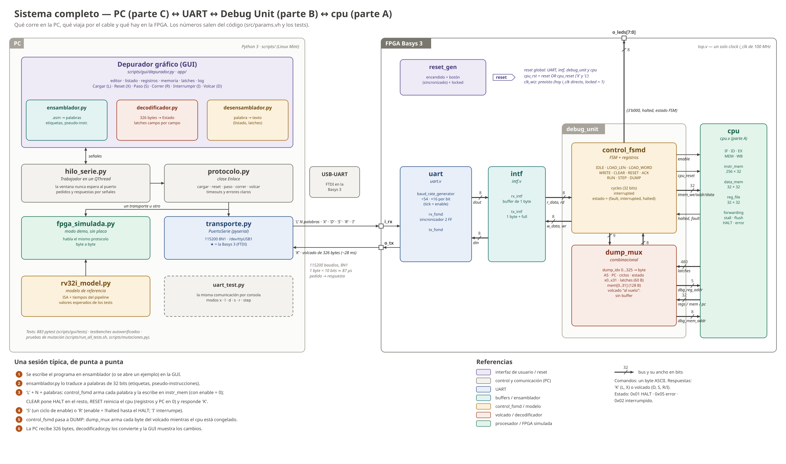
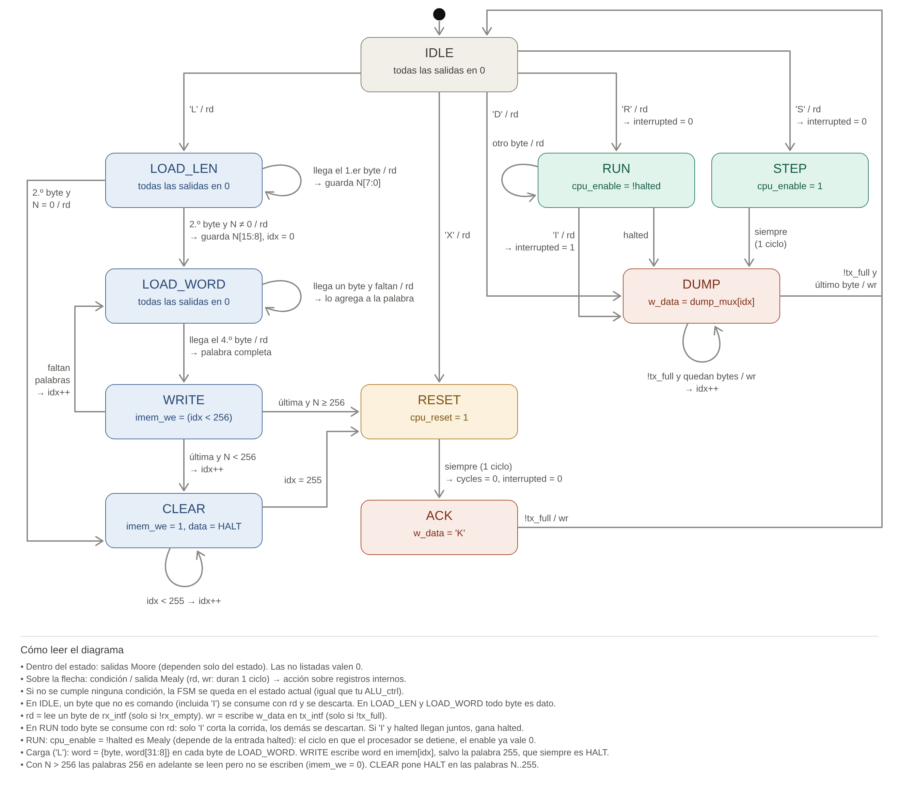
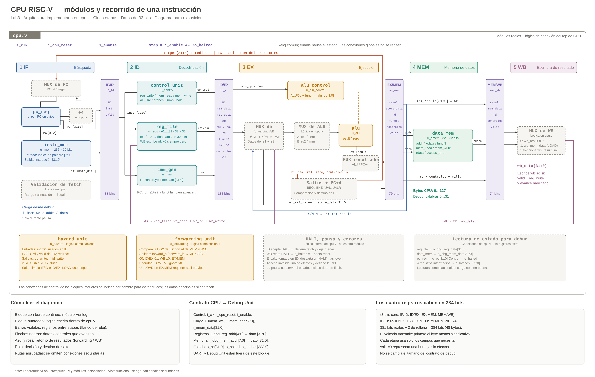

# Estudio para la defensa — Trabajo Final (pipeline RISC-V + Debug Unit + software)

Documento de estudio para los dos integrantes. Está basado en **conceptos**:
qué es cada cosa, cómo está en nuestro TP, por qué lo hicimos así y qué nos
pueden preguntar. El código aparece solo en la sección 5 (*red flags*).

**Fuente de verdad:** el código y la documentación del repo. Cada número
sale del código (`src/`, `src/params.vh`) o de los tests. Lo que solo se
puede saber con Vivado o con la placa está marcado como `[COMPLETAR: …]` y
listado en la sección 7.

Documentos relacionados: [`decisiones_de_diseno.md`](decisiones_de_diseno.md)
(las 50 decisiones numeradas), [`instrucciones_cpu.md`](instrucciones_cpu.md),
[`manual_depurador.md`](manual_depurador.md) y
[`CHECKLIST_placa.md`](CHECKLIST_placa.md).

---

## Índice

1. [Resumen en una página](#1-resumen-en-una-página)
2. [Conceptos](#2-conceptos)
   - [2.1 ISA RV32I](#21-isa-rv32i) · [2.2 Del monociclo al pipeline](#22-del-monociclo-al-pipeline) · [2.3 Latches](#23-latches-registros-de-pipeline)
   - [2.4 Riesgos estructurales](#24-riesgos-estructurales) · [2.5 Riesgos de datos](#25-riesgos-de-datos-forwarding-y-load-use) · [2.6 Riesgos de control](#26-riesgos-de-control)
   - [2.7 HALT y errores](#27-halt-y-errores) · [2.8 Clock enable](#28-control-de-la-ejecución-sin-tocar-el-clock) · [2.9 Timing](#29-timing)
   - [2.10 Memorias en FPGA](#210-memorias-en-fpga) · [2.11 UART](#211-uart) · [2.12 Debug Unit](#212-debug-unit)
   - [2.13 Reprogramar y "sin HALT"](#213-reprogramar-y-qué-pasa-si-no-hay-halt) · [2.14 Parte C](#214-parte-c-software) · [2.15 Verificación](#215-verificación) · [2.16 Contrato y trabajo en paralelo](#216-contrato-y-trabajo-en-paralelo)
3. [Diagramas y cómo explicarlos](#3-diagramas-y-cómo-explicarlos)
4. [Guion de presentación](#4-guion-de-presentación-3-a-5-minutos)
5. [Red flags en el código](#5-red-flags-en-el-código)
6. [Glosario y hoja de repaso](#6-glosario-y-hoja-de-repaso)
7. [Lista de COMPLETAR](#7-lista-de-completar)

---

## 1. Resumen en una página

### Qué hace el sistema (en 5 líneas)

1. Un **procesador RISC-V de 32 bits** (32 instrucciones de RV32I + un HALT propio) con **pipeline de 5 etapas** (IF, ID, EX, MEM, WB), con forwarding, stall por load-use y flush en saltos.
2. Una **Debug Unit** en la misma FPGA (Basys 3) que habla con la PC por **UART** y controla al procesador: carga el programa, lo resetea, lo hace avanzar un ciclo o correr, y manda un **volcado** con todo su estado.
3. El procesador **nunca toca el clock**: la Debug Unit lo hace avanzar con un *clock enable*.
4. En la PC, un **ensamblador** traduce el programa, un **modelo de referencia** calcula qué debería pasar y una **GUI** muestra registros, memoria y latches.
5. Todo está verificado con testbenches autoverificados, un modelo independiente y pruebas de mutación.

### Números clave (de memoria)

| Qué | Valor | De dónde sale |
|---|---|---|
| Clock | 100 MHz (sin `clk_wiz` todavía) | `top.v`, `top.xdc` (10 ns) |
| Baud rate | **115200**, 8N1 | `params.vh` |
| Sobremuestreo | **×16** (16 ticks por bit) | `baud_rate_generator.v` |
| Divisor | **54** = round(100 000 000 / (115200 · 16)) → baud real 115 741, error **+0,47 %** | `baud_rate_generator.v` |
| Un byte por UART | 10 bits ≈ **86,8 µs** ≈ 8680 ciclos | cálculo |
| Volcado | **326 bytes** ≈ **28,3 ms** | `params.vh` §6 |
| Latches | **480 bits** = 15 palabras (381 bits reales) | `params.vh` §4b |
| Memoria de programa | **256 × 32** (1 KiB), RAM distribuida, lectura asincrónica | `instr_mem.v` |
| Memoria de datos | **32 × 32** (128 bytes), RAM distribuida, escritura por byte | `data_mem.v` |
| Banco de registros | 32 × 32, flip-flops (con reset) | `reg_file.v` |
| Latencia del HALT | 5 NOPs + HALT → `o_halted` a los **9 ciclos** (N + 4) | `tb_cpu_isa` A4 |
| PC al detenerse | dirección del HALT **+ 4** | `params.vh` §4 |
| Stall load-use | **1 ciclo** | `hazard_unit.v`, `tb_cpu_isa` A6 |
| Penalidad de salto tomado | **2 ciclos** (se resuelve en EX) | `hazard_unit.v`, `tb_cpu_isa` A7 |
| Fórmula de ciclos | instrucciones + 4 + stalls + 2 × saltos tomados | `rv32i_model.py` |
| Contador de ciclos | 32 bits → da la vuelta a los ~43 s | `control_fsmd.v` |
| Estado del volcado | 0x01 HALT · 0x05 error · 0x02 interrumpido | `params.vh` §6 |
| Frecuencia final | `[COMPLETAR: frecuencia final]` | Vivado |
| WNS | `[COMPLETAR: WNS a la frecuencia final]` | Vivado |

### Una sesión típica, de punta a punta

1. **Escribir** el programa en ensamblador en la GUI (o abrir un ejemplo).
2. **Ensamblar:** `ensamblador.py` lo traduce a palabras de 32 bits (resuelve etiquetas y pseudo-instrucciones).
3. **`'L'`:** la PC manda `'L'`, la cantidad N (2 bytes) y las N palabras. La Debug Unit escribe cada palabra en la memoria de programa con el procesador pausado, pone HALT en el resto (CLEAR), resetea el procesador y responde `'K'`.
4. **`'S'` o `'R'`:** `'S'` da **un** ciclo de enable; `'R'` deja el enable en 1 hasta el HALT (o hasta `'I'`).
5. **Volcado:** la Debug Unit manda 326 bytes (cabecera 0xA5, PC, ciclos, estado, 32 registros, latches y 32 palabras de memoria) mientras el procesador está congelado.
6. **GUI:** `decodificador.py` convierte los bytes en campos con nombre y la ventana muestra qué cambió.

---

## 2. Conceptos

Formato de cada tema: **Concepto** → **En nuestro TP** → **Por qué** → **Preguntas probables** → **Repreguntas y trampas**.

### 2.1 ISA RV32I

**Concepto.** La ISA (*Instruction Set Architecture*) es el "contrato" entre el software y el hardware: qué instrucciones hay, cómo se codifican y qué hacen. RV32I es la base entera de RISC-V de 32 bits: registros de 32 bits, instrucciones de 32 bits, 32 registros (x0 vale siempre 0).

**Formatos.** Toda instrucción tiene el **opcode** en los bits [6:0]. Los campos de registro están **siempre en el mismo lugar**:

| Formato | Para qué | Campos |
|---|---|---|
| R | registro-registro (`add`, `sub`, `sll`…) | funct7 · rs2 · rs1 · funct3 · rd · opcode |
| I | inmediato, loads, `jalr` | imm[11:0] · rs1 · funct3 · rd · opcode |
| S | stores | imm[11:5] · rs2 · rs1 · funct3 · imm[4:0] · opcode |
| B | `beq`, `bne` | imm[12\|10:5] · rs2 · rs1 · funct3 · imm[4:1\|11] · opcode |
| U | `lui` | imm[31:12] · rd · opcode |
| J | `jal` | imm[20\|10:1\|11\|19:12] · rd · opcode |

- **rs1 siempre en [19:15], rs2 en [24:20], rd en [11:7]:** el banco de registros se puede leer **antes** de saber qué instrucción es (en paralelo con la decodificación). Por eso el inmediato de S, B y J está "partido": se movieron los bits del inmediato para no mover los registros.
- **El bit 31 es siempre el signo del inmediato:** la extensión de signo se hace igual para todos los formatos, sin esperar a decodificar.
- **B y J no guardan el bit 0** del desplazamiento: las instrucciones están siempre en direcciones pares (múltiplos de 2 en RISC-V con comprimidas; de 4 en nuestro caso). Ese bit siempre vale 0, así que guardarlo sería desperdiciar un bit: con el mismo campo se llega el doble de lejos (±4 KiB en B, ±1 MiB en J).
- **Con signo y sin signo:** `slt` compara con signo, `sltu` sin signo (−1 = 0xFFFFFFFF es *menor* que 3 con signo, pero *mayor* sin signo). `lb`/`lh` extienden el signo; `lbu`/`lhu` completan con ceros. `sra` (aritmético) copia el bit de signo al desplazar a la derecha; `srl` (lógico) mete ceros. `sub` y `sra` se distinguen de `add` y `srl` por el **bit 30** (funct7).

**En nuestro TP.** `control_unit` decodifica opcode, funct3 y funct7 y valida que la instrucción sea una de las 32 soportadas (más HALT); `imm_gen` reconstruye el inmediato; `alu_control` elige la operación de la ALU. Instrucciones: add sub sll srl sra and or xor slt sltu, addi andi ori xori slti sltiu slli srli srai, lb lh lw lbu lhu, sb sh sw, beq bne, jal jalr, lui, y **HALT = 0x00000000**.

**Por qué HALT = 0x00000000.** No es una instrucción válida de RISC-V (opcode 0000000), así que no choca con nada. Además, **una memoria vacía (en cero) es una parada**: después de un `'L'` las palabras sin usar quedan en HALT, y un programa que "se cae" del final se detiene. Alternativa descartada: usar `ecall`/`ebreak` (son instrucciones reales que no implementamos) o un opcode inventado distinto de cero.

**Preguntas probables**

- *¿Por qué los registros están siempre en la misma posición?* — Para poder leer el banco de registros en ID al mismo tiempo que se decodifica, sin esperar a saber el formato. Simplifica el hardware y acorta el camino crítico.
- *¿Cómo se forma el inmediato de un `beq`?* — Se juntan los bits 31, 7, 30:25 y 11:8 y se agrega un 0 abajo: `{signo×19, i[31], i[7], i[30:25], i[11:8], 0}`. Es un desplazamiento en bytes relativo al PC del `beq`.
- *¿Qué diferencia hay entre `sra` y `srl`?* — `srl` mete ceros a la izquierda (división sin signo); `sra` replica el bit de signo (división con signo hacia −∞). Por ejemplo, −8 `sra` 1 = −4, pero −8 `srl` 1 es un número positivo enorme.
- *¿Qué pasa con una instrucción que no está en la lista (`mul`)?* — `control_unit` la marca como **ilegal**: no escribe nada y el procesador se detiene con estado de error 0x05. El ensamblador ni siquiera la ensambla (hay que escribirla con `.word`).

**Repreguntas y trampas**

- *"¿x0 se puede escribir?"* — Se puede **intentar** (por ejemplo, `addi x0, x1, 5`), pero el banco descarta la escritura (`rd != 0` en la habilitación) y las lecturas de x0 devuelven 0 siempre, también por el puerto de debug.
- *"¿Por qué `addi` con un inmediato negativo no se convierte en `sub`?"* — Porque en las instrucciones tipo I, `alu_control` usa el bit 30 **solo** para distinguir `srli` de `srai` (funct3 = 101). En `addi` ese bit es parte del inmediato.
- *"¿`lui` usa la ALU?"* — Sí: suma 0 + inmediato (el operando A se fuerza a 0 con `alu_src_a`). Así no hace falta un camino aparte.
- *"¿Implementaron `auipc`?"* — No, no está en la consigna. El ensamblador da un error explícito si se usa.

### 2.2 Del monociclo al pipeline

**Concepto.** En un procesador **monociclo**, cada instrucción hace todo (buscar, decodificar, ejecutar, memoria, escribir) en un solo ciclo largo: el período lo fija la instrucción más lenta. En un **pipeline** se divide el trabajo en etapas separadas por registros; cada etapa trabaja sobre una instrucción distinta, como una línea de montaje.

| Etapa | Qué hace | En nuestro TP |
|---|---|---|
| IF | busca la instrucción en la dirección PC | `pc_reg`, `instr_mem`, +4 |
| ID | decodifica, lee registros, arma el inmediato | `control_unit`, `reg_file`, `imm_gen` |
| EX | calcula (ALU) y resuelve saltos | `alu`, `alu_control`, forwarding, saltos |
| MEM | lee o escribe la memoria de datos | `data_mem` |
| WB | escribe el resultado en el registro destino | mux de WB → `reg_file` |

- **Latencia contra throughput:** cada instrucción tarda **5 ciclos** en atravesar el pipeline (latencia), pero en régimen termina **una por ciclo** (throughput). El ciclo es más corto que en el monociclo, porque solo tiene que alcanzar para la etapa más lenta.
- **CPI** (ciclos por instrucción): ideal = 1; el real es mayor por los stalls y los saltos.
- **Nuestra fórmula** (sale del modelo y la verifican los tests): **ciclos = N + 4 + stalls + 2 × saltos tomados**, donde N es la cantidad de instrucciones ejecutadas antes del HALT. El "+ 4" es llenar y vaciar el pipeline: la primera instrucción tarda 5 ciclos en salir y después sale una por ciclo. Ejemplo: 5 NOPs + HALT = 5 + 4 = **9 ciclos**.

**Por qué 5 etapas.** Es el diseño clásico de Patterson & Hennessy (la referencia de la materia), equilibra el trabajo entre etapas y los riesgos tienen soluciones conocidas.

**Preguntas probables**

- *¿Cuánto mejora el pipeline?* — En el mejor caso hasta 5 veces en throughput (una instrucción por ciclo, con un ciclo ~5 veces más corto). En la práctica menos, por los riesgos, el desbalance entre etapas y el overhead de los registros.
- *¿Cuál es el CPI de `fibonacci`?* — 106 ciclos para 82 instrucciones: CPI ≈ 1,29. La diferencia son los 4 de llenado y 2 × 10 saltos tomados.
- *¿Una instrucción tarda menos con pipeline?* — No: tarda **más** (5 ciclos más el overhead de los registros). Lo que mejora es cuántas terminan por segundo.

**Repreguntas y trampas**

- *"Si el pipeline es de 5 etapas, ¿por qué son N + 4 y no N + 5?"* — Porque la última instrucción útil termina en el ciclo N + 4 (tarda 5 ciclos y empieza en el ciclo N). Nuestro HALT se detecta en ID, pero `o_halted` sube cuando el **marcador** del HALT llega a WB: eso también da N + 4, contando N como las instrucciones antes del HALT.
- *"¿El 'paso' ejecuta una instrucción?"* — No: ejecuta **un ciclo**. En un ciclo, cada instrucción del pipeline avanza una etapa.

### 2.3 Latches (registros de pipeline)

**Concepto.** Entre cada par de etapas hay un registro (lo llamamos "latch", aunque en realidad son **flip-flops por flanco**, no latches sensibles a nivel). Guarda todo lo que la instrucción necesita para las etapas siguientes: datos **y** señales de control. Así cada etapa trabaja sobre "su" instrucción sin mezclarse con las otras.

**En nuestro TP** (campos reales; en el volcado cada latch ocupa palabras enteras):

| Latch | Guarda | Bits reales → en el volcado |
|---|---|---|
| IF/ID | pc, instrucción, valid | 65 → 96 |
| ID/EX | pc, rs1_data, rs2_data, imm, rs1/rs2/rd, funct3, bit 30, 16 controles, halt, illegal, valid | 163 → 192 |
| EX/MEM | result, store_data, rd, funct3, controles de MEM y WB, halt, illegal, valid | 79 → 96 |
| MEM/WB | result, mem_data, rd, reg_write, result_src, halt, illegal, valid | 74 → 96 |

- **Las señales de control "se gastan":** ID/EX lleva todas (las de EX, MEM y WB); EX/MEM ya no lleva las de la ALU (se usaron en EX); MEM/WB solo lleva las de WB.
- **Burbuja:** una "instrucción vacía" que no hace nada. Se marca con **`valid = 0`** y todos los campos en 0 (IF/ID guarda la instrucción NOP 0x00000013, **nunca** 0x00000000, que sería HALT).
- **`halt`**: marcador de parada que baja con la instrucción hacia WB. **`illegal`**: la parada es por error (también se pone si el error fue un acceso a memoria).
- **480 bits:** cada latch se rellena hasta palabras enteras de 32 bits, así en el volcado cada PC o dato ocupa una palabra propia y se lee bien en hexadecimal (decisión 34). La tabla campo por campo está en `params.vh` §4b, y la GUI la muestra con nombres.

**Por qué guardar `valid` en lugar de "todo en cero".** Una instrucción en cero sería HALT, y un NOP real no se distingue de una burbuja. Con `valid`, las etapas saben si hay algo útil, y el forwarding y el hazard lo usan para no reaccionar a burbujas.

**Preguntas probables**

- *¿Por qué ID/EX guarda rs1 y rs2 (los números) además de los datos?* — Para el forwarding: en EX hay que comparar qué registros usa la instrucción contra el `rd` de las que están en MEM y WB.
- *¿Por qué EX/MEM no guarda el PC?* — Porque MEM y WB no lo necesitan: el `PC + 4` de `jal`/`jalr` ya viaja como `result`.
- *¿Qué ves en el volcado cuando el procesador se detiene?* — Todo vacío (burbujas) menos MEM/WB, que tiene el marcador del HALT (`valid = 1`, `halt = 1`): la palabra 0 del volcado vale 0x00000005.

**Repreguntas y trampas**

- *"¿Son latches o flip-flops?"* — Flip-flops por flanco de subida. Un latch de verdad (transparente por nivel) en una FPGA sería una mala práctica: problemas de timing y de glitches.
- *"¿Agregaron registros solo para el volcado?"* — No: `o_latches` es solo una concatenación de cables (más relleno en cero), sin registros extra.

### 2.4 Riesgos estructurales

**Concepto.** Hay un riesgo estructural cuando dos instrucciones necesitan **el mismo recurso** en el mismo ciclo (por ejemplo, una sola memoria para instrucciones y datos).

**En nuestro TP.**
- **Memorias separadas** (arquitectura Harvard): IF lee la memoria de programa mientras MEM usa la de datos.
- **Banco de registros con 2 lecturas y 1 escritura:** ID lee dos registros mientras WB escribe uno.
- **Bypass WB → ID dentro del banco:** si en el mismo ciclo WB escribe el registro que ID está leyendo, el banco entrega **el dato nuevo** (no el viejo). Sin eso habría que esperar un ciclo más (o escribir en el primer medio ciclo y leer en el segundo, como en el libro, pero eso necesita los dos flancos del clock).

**Preguntas probables**

- *¿Qué pasaría con una sola memoria?* — En el ciclo en que un `lw` está en MEM, IF no podría buscar: habría que frenar un ciclo por cada load o store.
- *¿Cómo resuelve el libro el caso escritura y lectura en el mismo ciclo?* — Escribe en el flanco de bajada y lee en el de subida. Nosotros usamos un solo flanco (está prohibido tocar el clock), así que lo resolvemos con un bypass combinacional.

**Repreguntas y trampas**

- *"¿El puerto de debug es un riesgo estructural?"* — No: es una lectura más (asincrónica) y solo se usa con el procesador congelado.

### 2.5 Riesgos de datos: forwarding y load-use

**Concepto.** Hay un riesgo de datos cuando una instrucción necesita un resultado que la anterior todavía no escribió en el banco. Ejemplo: `add x1, x2, x3` seguido de `sub x4, x1, x5`: cuando `sub` está en EX, el `add` está recién en MEM.

**Forwarding (adelantamiento).** En vez de esperar, se toma el dato de donde ya está:
- **EX/MEM → EX:** el resultado de la instrucción anterior.
- **MEM/WB → EX:** el de la de hace dos.

**En nuestro TP** (`forwarding_unit`). Para cada operando (rs1 y rs2) de la instrucción en EX, la condición completa es:

> la instrucción en EX es válida **y** usa ese registro, **y** la de EX/MEM (o MEM/WB) es válida, escribe un registro, su `rd` es igual **y `rd ≠ 0`**.

- **Prioridad EX/MEM sobre MEM/WB:** si las dos escriben el mismo registro, el dato más nuevo es el de EX/MEM.
- **Un load en EX/MEM no se adelanta:** su dato recién sale de la memoria en MEM.
- **Hacia dónde va:** a los dos operandos de la ALU, al **dato de un store** y a la comparación de los saltos.
- Selección: 00 = ID/EX (sin forwarding), 10 = EX/MEM, 01 = MEM/WB.

**Load-use.** `lw x1, 0(x2)` seguido de `add x3, x1, x1`: cuando `add` necesita x1 en EX, el `lw` está en MEM **leyendo** la memoria; el dato existe recién al final de ese ciclo. El forwarding no alcanza porque el dato llegaría "tarde" (habría que pasar por la memoria y la ALU en el mismo ciclo).

**En nuestro TP** (`hazard_unit`). Si hay un load válido en EX con `rd ≠ 0` y la instrucción en ID usa ese registro:
1. se **congela el PC** y el **IF/ID** (no entra nada nuevo);
2. se mete una **burbuja en ID/EX**;
3. las etapas de adelante siguen.

Al ciclo siguiente el load está en WB y el dato llega por forwarding MEM/WB → EX. Cuesta **exactamente 1 ciclo** (en el paso a paso, el PC se repite una vez: `tb_cpu_isa` A6 lo verifica).

**Por qué así.** Es la solución estándar del libro. Las alternativas eran: (a) que el compilador o el programador inserte NOPs (el hardware no sería correcto solo), o (b) frenar siempre sin forwarding (un ciclo o dos por cada dependencia).

**Preguntas probables**

- *¿Por qué `rd ≠ 0` en la condición?* — Porque x0 siempre vale 0: si una instrucción "escribe" x0 (por ejemplo, `addi x0, x1, 7`), el valor calculado no debe adelantarse a quien lea x0.
- *¿Por qué EX/MEM tiene prioridad?* — Porque es el resultado más reciente. Ejemplo: `addi x1, x1, 1` dos veces seguidas y después un uso de x1: hay que tomar el segundo.
- *¿Cuántos ciclos cuesta un load-use?* — Uno. Con una instrucción independiente en el medio, cero.
- *¿El dato de un store se adelanta?* — Sí: `rs2` del store pasa por el mismo multiplexor de forwarding que el operando B. Pero si viene de un load inmediatamente anterior, también hay stall (lo trata como un uso).

**Repreguntas y trampas**

- *"¿Y si el load escribe x0?"* — No hay stall: el `rd ≠ 0` también está en el hazard.
- *"¿Y el caso de dos instrucciones de distancia (WB y ID en el mismo ciclo)?"* — Lo cubre el bypass WB → ID del banco (sección 2.4), no la `forwarding_unit`.
- *"¿Se podría evitar el stall del load-use?"* — Con forwarding MEM → MEM para un store que guarda el dato recién cargado sí; en el caso general no, a menos que el compilador reordene instrucciones.
- *"¿Qué se congela exactamente?"* — PC e IF/ID (enable de escritura en 0), y en ID/EX entra una burbuja. EX/MEM y MEM/WB siguen avanzando.

### 2.6 Riesgos de control

**Concepto.** Después de un salto, el procesador no sabe cuál es la próxima instrucción hasta evaluar la condición. Mientras tanto, IF ya fue buscando las siguientes en secuencia.

**En nuestro TP.**
- Los saltos (`beq`, `bne`, `jal`, `jalr`) se **resuelven en EX**, con los operandos ya corregidos por forwarding. `beq`/`bne` comparan restando en la ALU (señal `zero`).
- Destino: `PC + inmediato` (beq, bne, jal) o `(rs1 + inmediato) & ~1` (jalr: se borra el bit 0, como pide la especificación).
- Si el salto se toma (`redirect`): el PC toma el destino y se hace **flush** de IF/ID e ID/EX (las 2 instrucciones buscadas de más se convierten en burbujas). **Penalidad: 2 ciclos.** EX/MEM no se toca: el salto mismo sigue (`jal` y `jalr` escriben `PC + 4` en rd).
- Política implícita: "predecir no tomado" (se sigue buscando en secuencia). Si no se toma, no se pierde nada.

**Por qué en EX.** Ahí ya están los operandos con forwarding y la ALU para comparar. **Alternativas descartadas:**
- **Resolver en ID:** penalidad de 1 ciclo, pero hace falta un comparador en ID y forwarding hacia ID, y aparece un riesgo nuevo (una instrucción ALU justo antes del salto obliga a frenar). Más complejo y alarga el camino crítico de ID.
- **Predicción dinámica** (tabla de historia, BTB): más hardware; para los programas del TP no vale la pena.
- **Delay slot:** cambia la semántica de la ISA (RISC-V no lo tiene).

**Preguntas probables**

- *¿Cuánto cuesta un salto tomado? ¿Y uno no tomado?* — 2 ciclos y 0 ciclos.
- *¿Qué se limpia en el flush?* — IF/ID e ID/EX. No EX/MEM, porque ahí está el salto, que tiene que terminar.
- *¿Por qué `jalr` hace `& ~1`?* — Lo pide la especificación RISC-V: el bit 0 del destino se ignora. Si el destino queda desalineado (no múltiplo de 4), nuestro fetch lo detecta y se detiene por error.
- *¿Qué pasa si después de un `beq` tomado viene un HALT?* — Ese HALT está en el camino equivocado: el salto en EX tiene prioridad y lo descarta (decisión de diseño; lo prueba `saltos.asm`).

**Repreguntas y trampas**

- *"¿El `jal` también tiene penalidad si siempre salta?"* — Sí, 2 ciclos, porque se resuelve en EX igual que los demás. Se podría resolver en ID (el destino no depende de registros), pero no lo hicimos para tener un solo mecanismo.
- *"¿Qué pasa si hay un stall y un salto al mismo tiempo?"* — En la `hazard_unit` gana el salto: la instrucción en ID es del camino equivocado y se descarta igual.

### 2.7 HALT y errores

**Concepto.** El programa tiene que poder terminar, y cuando termina el pipeline tiene que quedar **vacío** (lo pide la consigna): todas las instrucciones anteriores al HALT terminadas y ninguna posterior ejecutada.

**En nuestro TP.**
1. El HALT (0x00000000) se **detecta en ID**. Desde ese ciclo se **deja de buscar** (el PC se congela) y lo que entra detrás son burbujas.
2. El HALT sigue bajando como un marcador (`halt = 1`) por ID/EX, EX/MEM y MEM/WB, sin escribir nada.
3. `o_halted = MEM/WB.valid && MEM/WB.halt`: sube cuando el marcador **llega a WB**. En ese flanco la instrucción anterior ya escribió su resultado.
4. Con `o_halted = 1`, `step = 0`: todo queda congelado hasta un reset.

- **Por qué 9 ciclos y no 10:** el cpu original esperaba a que el marcador *saliera* de WB (10 ciclos con 5 NOPs + HALT). El contrato y el stub de la Debug Unit cuentan 9, así que se corrigió el cpu (decisión 28). Además se ahorró un flip-flop.
- **PC = HALT + 4:** cuando el HALT llega a ID, IF ya buscó la instrucción siguiente. Mostrar la dirección del HALT obligaría a guardar otro registro solo para eso (decisión 29).

**Errores (`o_fault`).** El procesador también se detiene, con `o_fault = 1` (estado **0x05**), si encuentra:
- una **instrucción ilegal** (no soportada);
- un **fetch fuera de la memoria** de programa (PC ≥ 1024) o desalineado: se inyecta 0xFFFFFFFF como instrucción ilegal;
- un **acceso inválido a la memoria de datos**: fuera de 0..127, `lh`/`sh` en dirección impar o `lw`/`sw` no múltiplo de 4.

Las instrucciones anteriores terminan; la que falla y las siguientes no tienen efecto. **No es un error:** un loop infinito (para eso está `'I'`), escribir en x0 o un desborde aritmético (`add` no genera excepción en RISC-V).

**Preguntas probables**

- *¿Cuándo sube `halted`?* — Cuando el HALT llega a WB: 3 ciclos habilitados después de detectarlo en ID. Con 5 NOPs + HALT, a los 9 ciclos.
- *¿Por qué el PC queda en HALT + 4?* — Porque el HALT se reconoce en ID, cuando IF ya avanzó el PC.
- *¿Se distingue un HALT de un error?* — Sí, por el bit 2 del estado (`o_fault`): 0x01 contra 0x05. No se distingue cuál de los tres errores fue.
- *¿Esto es una excepción de RISC-V?* — No: es una parada simple, sin traps ni registros de causa.

**Repreguntas y trampas**

- *"¿El pipeline queda vacío en el modo paso a paso?"* — Sí: es el mismo hardware; en los dos modos `halted` sube con todo lo anterior terminado.
- *"¿Qué pasa si se manda `'S'` con el procesador detenido?"* — El enable se ignora: el volcado sale igual y los ciclos no suben.
- *"¿Y si hay un HALT en el camino equivocado de un salto?"* — No detiene: el salto en EX lo descarta antes.

### 2.8 Control de la ejecución sin tocar el clock

**Concepto.** Para pausar un circuito hay dos formas:
- **Clock gating** (cortar el clock con una compuerta AND): **prohibido** en este TP y mala práctica en FPGA. El clock pasaría por lógica común (no por la red dedicada de clock), con glitches (pulsos falsos) y **skew** (llega a destiempo a distintos flip-flops), y se rompe el análisis de timing.
- **Clock enable:** el clock llega siempre a todos los flip-flops, y cada uno tiene una entrada de habilitación (CE): con enable = 0 conserva su valor. Las FPGA tienen el CE en el mismo flip-flop, así que no cuesta nada.

**En nuestro TP.**
- Un solo clock (`i_clk`) para todo el diseño. El procesador recibe `i_enable` y arma `step = i_enable && !o_halted`, que habilita PC, latches, banco de registros, escritura de datos y el registro de parada.
- **Paso a paso (`'S'`):** el estado STEP de la Debug Unit dura **un ciclo** con enable = 1 (salida **Moore**), así el procesador avanza exactamente un flanco.
- **Continuo (`'R'`):** en el estado RUN, `enable = !halted` (salida **Mealy**). En el mismo ciclo en que `halted` sube, el enable ya es 0: la Debug Unit no depende de que el procesador ignore el enable.
- El tick del baud rate tampoco es un clock: es un pulso de 1 ciclo usado como enable.

**Preguntas probables**

- *¿Por qué no se puede cortar el clock?* — Por los glitches, el skew y porque Vivado ya no puede analizar bien el timing. Con clock enable, el clock sigue en su red dedicada.
- *¿Cómo hacen el paso a paso?* — Un ciclo de enable. El procesador recibe un único flanco habilitado.
- *¿Por qué el enable de RUN es Mealy?* — Para que en el ciclo en que el procesador se detiene el enable ya baje, sin un ciclo de retraso. Así el contador de ciclos queda exacto: un `'R'` suma lo mismo que los `'S'` equivalentes.

**Repreguntas y trampas**

- *"¿Y si el enable dura dos ciclos?"* — Avanzaría dos ciclos. Por eso STEP es un estado de un solo ciclo, y la salida es Moore (depende solo del estado).
- *"¿La memoria de programa se puede escribir mientras corre?"* — No: la escritura solo se acepta con enable = 0 (doble protección: la Debug Unit escribe en estados donde el enable es 0, y el cpu ignora la escritura si el enable vale 1).

### 2.9 Timing

**Concepto.**
- **Setup:** el dato tiene que llegar a un flip-flop un tiempo **antes** del flanco. **Hold:** tiene que mantenerse un tiempo **después**.
- **Slack:** cuánto margen sobra. Setup slack = tiempo disponible − tiempo que tarda el camino. Positivo = cumple; negativo = falla.
- **WNS** (*Worst Negative Slack*): el peor slack de setup de todo el diseño. Si es ≥ 0, todos los caminos cumplen. **TNS:** la suma de todos los slacks negativos (0 si todo cumple). Para hold: WHS y THS.
- **Camino crítico:** el camino combinacional más lento entre dos flip-flops. Fija la frecuencia máxima: f_max ≈ 1 / (período − WNS).
- **Skew:** diferencia en el momento en que el clock llega a distintos flip-flops. Si es grande puede violar setup o hold. En la FPGA el clock va por una red global (BUFG) con poco skew; por eso no hay que generar ni cortar clocks con lógica.

**En nuestro TP.**
- Un solo clock de 100 MHz (período de 10 ns), `create_clock` en el xdc.
- **Caminos críticos probables** (a confirmar con Vivado):
  1. EX: forwarding → resta de la ALU → `zero` → decisión del salto → próximo PC y flush;
  2. MEM: dirección → chequeo de rango → error → flush y PC;
  3. `o_halted`, que es combinacional y llega al enable de más de mil flip-flops (el banco de registros solo tiene 1024): mucho fan-out.
- Resultado: `[COMPLETAR: WNS / TNS / WHS / THS a 100 MHz]`, `[COMPLETAR: camino crítico real: origen, destino, niveles de lógica, retardo]`.
- **`clk_wiz` (MMCM):** genera otra frecuencia a partir de los 100 MHz: f_out = f_in · M / (D · O), con f_VCO = f_in · M / D dentro del rango del VCO (en Artix-7 -1, 600 a 1200 MHz `[COMPLETAR: confirmar en la hoja de datos]`). Su salida `locked` indica que el clock es estable; mientras vale 0 el sistema tiene que estar en reset. **En nuestro TP todavía no está**: `reset_gen` ya tiene la entrada `i_locked`, hoy atada a 1. `[COMPLETAR: frecuencia final y valores M, D y O si se agrega]`.
- **`CLK_FREQ` tiene que coincidir con el clock real:** el divisor de la UART se calcula con ese parámetro. Si el clock fuera de 50 MHz pero `CLK_FREQ` siguiera en 100 MHz, la UART transmitiría a la mitad de velocidad (57600) y la PC recibiría basura.

**Preguntas probables**

- *¿Cuál es el camino crítico?* — `[COMPLETAR]`. Lo esperable es el del salto en EX (forwarding + ALU + decisión).
- *¿Cómo se elige la frecuencia?* — Se sintetiza, se mira el WNS, y si es negativo se baja la frecuencia con el `clk_wiz` hasta que cumpla (o se acorta el camino crítico).
- *¿Qué es el skew y qué consecuencias tiene?* — Que el clock llegue a destiempo: puede hacer que un flip-flop capture un dato viejo o uno nuevo antes de tiempo. Se evita usando la red de clock dedicada y no generando clocks con lógica.

**Repreguntas y trampas**

- *"¿Un WNS positivo es malo?"* — No: si es positivo, todo cumple (el nombre confunde).
- *"¿Por qué no subir a 200 MHz?"* — Porque el camino crítico (ALU + salto + forwarding en un ciclo) no entra en 5 ns `[COMPLETAR con el dato real]`.
- *"¿Cómo acortarían el camino crítico?"* — Comparar `rs1 == rs2` directamente (sin pasar por la resta de la ALU), resolver los saltos en ID o agregar una etapa más.

### 2.10 Memorias en FPGA

**Concepto.** Una FPGA tiene dos tipos de RAM:
- **RAM distribuida** (LUTRAM): se arma con las LUT. Tamaños chicos, **lectura asincrónica** (el dato sale en el mismo ciclo, como lógica combinacional).
- **Block RAM (BRAM):** bloques dedicados de 36 Kb. Tamaños grandes, pero **lectura sincrónica** (el dato sale un ciclo después del flanco).

**En nuestro TP.**
- Memoria de programa: **256 × 32**, RAM distribuida (`ram_style = "distributed"`), lectura asincrónica.
- Memoria de datos: **32 × 32 (128 bytes)**, RAM distribuida, **escritura por byte** (para `sb`/`sh`), una lectura para el cpu y otra para el debug.
- Banco de registros: flip-flops (tiene reset y 3 lecturas).

**Por qué distribuida y no BRAM.** Con lectura asincrónica, IF lee la instrucción y MEM lee el dato **en el mismo ciclo**: el pipeline queda como en el libro. Con BRAM habría que agregar un ciclo de latencia (o registrar la dirección un ciclo antes) y cambiar el tiempo de los stalls. Además, el debug lee la memoria de forma asincrónica (dato válido en el mismo ciclo) para armar el volcado al vuelo. Los tamaños son chicos, así que no hace falta BRAM.

**Por qué 256 y 32 palabras.**
- 256 palabras de programa alcanzan para los programas del TP y caben en una dirección de 8 bits (la del comando `'L'`).
- 32 palabras de datos son **exactamente** lo que muestra el volcado: toda la memoria de datos es visible, y la consigna pide "el contenido de la memoria de datos usada" (decisión 31). Un acceso afuera se detiene con error en lugar de escribir donde nadie lo ve.

**Preguntas probables**

- *¿Qué es RAM distribuida?* — RAM armada con LUT: chica y con lectura combinacional.
- *¿Por qué no BRAM?* — Lectura sincrónica: cambiaría la latencia del pipeline. Y las memorias son chicas.
- *¿Cómo hacen `sb`?* — La palabra tiene 4 bytes; una máscara de 4 bits habilita solo el byte (o los 2 de `sh`) que corresponde según `addr[1:0]`.
- *¿El reset borra las memorias?* — No: las dos son RAM. La de programa la limpia el CLEAR de `'L'`; la de datos conserva lo del programa anterior (decisión 32).

**Repreguntas y trampas**

- *"¿Seguro que Vivado la armó como RAM?"* — `[COMPLETAR: Utilization / Synthesis Log: LUT as Distributed RAM]`. La escritura por byte es el punto delicado. Si saliera como flip-flops, se escribe como 4 memorias de 8 bits.
- *"¿Por qué el banco de registros es de flip-flops?"* — Porque tiene reset (se borra con `'X'` y `'L'`) y 3 lecturas (rs1, rs2 y debug); una LUTRAM no se borra en un ciclo.

### 2.11 UART

**Concepto.** UART es una comunicación serie **asincrónica**: no viaja un clock, cada lado tiene el suyo y se ponen de acuerdo en la velocidad. **8N1:** 1 bit de start (0), **8** bits de datos (el menos significativo primero), **N**o paridad, **1** bit de stop (1). La línea en reposo vale 1. Cada byte son 10 bits.

**En nuestro TP** (`uart` = `baud_rate_generator` + `rx_fsmd` + `tx_fsmd`, más `intf`):
- **115200 baudios:** un volcado de 326 bytes tarda ≈ 28 ms (a 9600 baudios serían ≈ 0,34 s). El puente USB-UART de la Basys 3 lo soporta sin problemas (decisión 1).
- **Sobremuestreo ×16:** el generador da 16 *ticks* por bit. El receptor detecta el flanco de bajada del start, cuenta 8 ticks para ubicarse en la **mitad** del bit (y verificar que sigue en 0, si no fue ruido) y después toma cada bit cada 16 ticks, justo en el centro.
- **Divisor:** N = round(100 MHz / (115200 · 16)) = round(54,25) = **54**. Baud real = 100 MHz / (54 · 16) = 115 741 → error **+0,47 %**. El límite tolerable es del orden del 2 %. Se **redondea** en lugar de truncar (decisión 2).
- **FSMD de Rx:** IDLE → START (medio bit) → DATA (8 bits) → STOP → DONE (1 ciclo, `rx_done` Moore). **FSMD de Tx:** arma la trama completa `{stop, dato, start}` en un registro y la desplaza cada 16 ticks.
- **`intf`:** dos buffers de 1 byte. `rx_intf` guarda el byte recibido y avisa `rx_empty = 0`; la Debug Unit lo consume con `rd`. `tx_intf` acepta un byte con `wr` cuando `tx_full = 0`.
- **Metaestabilidad:** `i_rx` cambia sin relación con el clock de la FPGA. Si cambia justo en la ventana de setup/hold, el flip-flop puede quedar un tiempo en un valor intermedio (metaestable). Solución: **sincronizador de 2 flip-flops** (`rx_meta`, `rx_sync`, que arrancan en 1); el botón de reset tiene otro.

**Preguntas probables**

- *¿Cómo calculan el divisor?* — Frecuencia / (baud × 16), redondeado: 54. El error queda en 0,47 %.
- *¿Por qué ×16?* — Para muestrear en el centro de cada bit, lejos de los flancos, y tolerar diferencias de velocidad entre los dos lados.
- *¿Qué es la metaestabilidad y cómo la evitan?* — Un flip-flop que muestrea una señal asincrónica puede quedar indeciso. Dos flip-flops en cascada le dan un ciclo entero para resolverse antes de llegar a la FSM.
- *¿Por qué alcanza un buffer de 1 byte?* — Porque la FSM consume cada byte al ciclo siguiente y el próximo tarda ≈ 8680 ciclos en llegar. Y el protocolo es pedido → respuesta.

**Repreguntas y trampas**

- *"¿El tick es un clock?"* — No: es un pulso de un ciclo que habilita a las FSM. Todo corre con `i_clk`.
- *"¿Qué pasa si el error de baud fuera del 5 %?"* — Al llegar al último bit, el punto de muestreo se corre más de medio bit y se leen bits equivocados.
- *"¿Por qué 2 flip-flops y no 1?"* — Con uno, la salida metaestable entra directo a la lógica. Con dos, la probabilidad de que siga metaestable después de un ciclo entero es despreciable (MTBF muy alto).

### 2.12 Debug Unit

**Concepto.** Es el puente entre la PC y el procesador: interpreta los comandos que llegan por la UART, controla el procesador (enable, reset, carga) y arma las respuestas.

**Por qué está dividida en dos** (decisión 8):
- **`control_fsmd`:** la máquina de estados con sus registros (el *protocolo*: cuándo pasa cada cosa).
- **`dump_mux`:** combinacional. Dado el índice del byte, arma ese byte del volcado y pone las direcciones de lectura de debug.

Son cosas de naturaleza distinta (secuencial y combinacional), se prueban por separado y coinciden con el diagrama.

**El protocolo** (pedido → respuesta, un byte ASCII por comando):

| Comando | Respuesta |
|---|---|
| `'L'` + N (2 bytes, LSB primero) + N palabras little-endian | `'K'` |
| `'X'` (reset del procesador) | `'K'` |
| `'D'` (volcado) | volcado |
| `'S'` (un ciclo) | volcado |
| `'R'` (correr) | volcado (al terminar o al llegar `'I'`) |
| `'I'` (interrumpir; solo durante RUN) | (la respuesta es el volcado del `'R'`) |

Un byte que no es comando se descarta, sin respuesta.

**Formato del volcado** (326 bytes, little-endian): `0xA5` · PC (4) · ciclos (4) · estado (1) · x0..x31 (128) · latches (60) · memoria de datos (128). **Estado:** bit 0 = detenido, bit 1 = interrumpido, bit 2 = error.

**Recorrido del diagrama de estados** (`docs/informe/img/debug_unit_fsm.png`), como para explicarlo con el diagrama en pantalla:

- **IDLE:** espera un byte. Lo lee siempre (`rd`). Según cuál sea va a RESET (`'X'`), LOAD_LEN (`'L'`), STEP (`'S'`), RUN (`'R'`) o DUMP (`'D'`). Cualquier otro byte, incluida una `'I'` acá, se descarta.
- **LOAD_LEN:** recibe N en 2 bytes, el menos significativo primero. Si N = 0 va directo a CLEAR; si no, a LOAD_WORD.
- **LOAD_WORD:** junta 4 bytes en el registro `word` con un desplazamiento a la derecha (`word = {byte, word[31:8]}`): el primero termina en [7:0], es decir little-endian. Con el 4.º pasa a WRITE.
- **WRITE:** un ciclo con `imem_we = 1` (salida Moore): escribe `word` en la palabra `idx`, salvo la 255, que siempre se escribe como HALT. Si faltan palabras vuelve a LOAD_WORD; si no, va a CLEAR. Las palabras desde la 256 se consumen pero no se escriben.
- **CLEAR:** escribe HALT en las palabras que quedan hasta la 255, una por ciclo (como mucho 256 ciclos ≈ 2,6 µs).
- **RESET:** un ciclo con `cpu_reset = 1`. Pone en 0 el contador de ciclos y el bit de interrumpido.
- **ACK:** manda `'K'` apenas el transmisor está libre y vuelve a IDLE.
- **STEP:** un ciclo con `cpu_enable = 1` y pasa a DUMP.
- **RUN:** `cpu_enable = !halted` (Mealy) y `rd = !rx_empty` (lee todo byte). Sale a DUMP si `halted` sube o si llega `'I'`. Si las dos cosas pasan en el mismo ciclo, **gana el HALT**.
- **DUMP:** cada vez que el transmisor está libre manda el byte `dump_idx` y avanza; después del 325 vuelve a IDLE.

**Salidas Moore y Mealy** (decisión 10):
- **Moore** (dependen solo del estado) para lo que controla al procesador: `cpu_reset`, `cpu_enable` en STEP, `imem_we`. Duran exactamente lo que dura el estado: por ejemplo, un ciclo.
- **Mealy** (estado + entrada) para el *handshake* con los buffers: `rd = !rx_empty`, `wr = !tx_full`; y `cpu_enable = !halted` en RUN, para cortar en el mismo ciclo.

**Volcado "al vuelo"** (decisión 12): no hay un buffer de 326 bytes. `dump_mux` calcula cada byte en el momento: según el índice pone la dirección de registro o de memoria (lecturas asincrónicas) y elige el byte. Como el procesador está congelado, todos los bytes son del mismo instante.

**`'L'` en detalle.** La PC manda todo seguido, sin esperar. Durante la carga **ningún byte es comando** (un 0x58 dentro de una palabra es un dato). El CLEAR garantiza que no queden restos del programa anterior, y la palabra 255 siempre es HALT. Con N > 256 se consumen todas las palabras (para no desincronizarse), pero solo se escriben las primeras.

**Contador de ciclos y LEDs.** `cycles` (32 bits) suma cada ciclo en que el procesador avanzó (enable y no detenido). Se pone en 0 con `'X'` y `'L'`. Los LEDs muestran `{0, 0, 0, halted, código de estado}`: IDLE 0, LOAD_LEN 1, LOAD_WORD 2, WRITE 3, RESET 4, ACK 5, RUN 6, STEP 7, DUMP 8, CLEAR 9.

**Reset global y reset del procesador** (decisión 5). El reset global (al encender durante 16 ciclos, o con el botón) resetea todo, UART incluida. El comando `'X'` resetea **solo** el procesador, así la comunicación no se corta y se puede responder `'K'`. En el top: `cpu_rst = reset OR cpu_reset`.

**Preguntas probables**

- *¿Por qué la FSM está separada del mux del volcado?* — Una es secuencial (cuándo) y la otra combinacional (qué byte). Se prueban por separado.
- *¿Cómo se arma una palabra de 32 bits con bytes?* — Con un registro que desplaza 8 bits a la derecha y mete el byte nuevo arriba: después de 4 bytes, el primero quedó abajo (little-endian).
- *¿Qué pasa si `'I'` y el HALT llegan juntos?* — Gana el HALT (el programa terminó solo) y la PC recibe un único volcado con estado 0x01.
- *¿Por qué un comando de interrupción específico y no cualquier byte?* — Para que un byte de ruido o un comando mandado por error no corte la corrida.

**Repreguntas y trampas**

- *"¿Qué pasa si se corta la transmisión a mitad de un `'L'`?"* — La FSM se queda esperando bytes: se recupera con el botón de reset (no hay timeout; decisión 25).
- *"¿Por qué el enable de STEP es Moore?"* — Para que dure exactamente un ciclo, sin depender de entradas.
- *"¿El estado tiene recuperación?"* — Sí: es one-hot de 10 bits y un estado inválido vuelve a IDLE.

### 2.13 Reprogramar y qué pasa si no hay HALT

**Las preguntas de la consigna** (nuestras respuestas, sección 11 de las decisiones):

| Pregunta | Respuesta | Por qué |
|---|---|---|
| ¿Hay que vaciar la memoria (de datos)? | **No.** Es RAM y el reset no la borra; conserva lo del programa anterior | Tiene que seguir siendo una RAM (decisión 32). Cada programa inicializa los datos que usa; el modelo lo verifica en los ejemplos |
| ¿Y los registros? | **Sí:** el reset que hace `'L'` (y `'X'`) los pone en 0 | Son estado del procesador: el programa nuevo no depende del anterior |
| ¿Hay que vaciar el pipeline? | **Sí:** el reset deja los 4 latches como burbujas y el PC en 0 | Si no, instrucciones del programa viejo que estaban adentro terminarían de ejecutarse |
| ¿Y la memoria de programa? | **No con el reset; sí con la carga:** el CLEAR escribe HALT en las palabras sin usar | El reset no la borra para poder volver a correr el mismo programa con `'X'`; el CLEAR evita restos |

**¿Qué pasa si no hay instrucción de parada?** No puede pasar del todo: después de un `'L'`, las palabras no usadas son HALT y la 255 siempre es HALT. Un programa que "se cae" del final se detiene en el primer HALT de relleno. Lo que sí puede pasar:
- un **loop infinito** (`j .`): `'R'` corre para siempre y se corta con `'I'` (estado 0x02);
- un salto **fuera de la memoria** o desalineado: error, estado 0x05.

**Repreguntas y trampas**

- *"¿Por qué no borrar la memoria de datos, si así un programa da siempre lo mismo?"* — Lo evaluamos y lo descartamos: una RAM no se borra con un reset (habría que hacerla con flip-flops, unos 1024, y el volcado ya no mostraría una memoria). La regla es la de cualquier computadora: el programa inicializa sus datos.
- *"¿El botón también conserva la memoria de datos?"* — Sí: el botón es el reset global, que también resetea el procesador pero no las memorias.

### 2.14 Parte C (software)

**Arquitectura** (decisiones 39 a 50; manual en `manual_depurador.md`):
- **`ensamblador.py`:** las 32 instrucciones, `halt`, etiquetas, comentarios con `#` y pseudo-instrucciones (`nop`, `j`, `mv`, `li`, `beqz`, `bnez`, `call`, `ret`). Dos pasadas: la primera calcula la dirección de cada etiqueta (`li` puede ocupar 1 o 2 palabras); la segunda codifica. Errores con número de línea; una instrucción RISC-V fuera de la consigna (`mul`, `blt`) da un error explícito.
- **`protocolo.py`:** la clase `Enlace` (cargar, reset, paso, correr con interrupción, volcar), con timeouts y errores claros.
- **`decodificador.py`:** los 326 bytes → un objeto con campos con nombre (registros, memoria, cada campo de cada latch).
- **`rv32i_model.py` (modelo de referencia):** ejecuta el programa por su cuenta (sin el RTL) y calcula los tiempos del pipeline con la fórmula de la sección 2.2: qué registros y qué memoria hay después de **cada** ciclo, el PC y cuándo se detiene. Sirve para los tests y para el modo demo.
- **GUI** (PySide6): la comunicación va en **otro hilo** (la ventana nunca espera al puerto); pedidos y respuestas viajan por señales de Qt.
- **Modo demo:** una FPGA simulada que habla **el mismo protocolo, byte por byte**, usando el modelo. Limitación: no simula los latches (se ven como burbujas, salvo al terminar).
- **Cómo la GUI sabe qué instrucción hay en cada etapa:** IF = la palabra del programa en la dirección del PC; ID = el campo `instr` de IF/ID; EX = la palabra en la dirección `pc` de ID/EX. EX/MEM y MEM/WB no guardan el PC: para saber qué hay en MEM y WB hace falta el volcado del ciclo anterior (EX/MEM copia lo que había en EX) o el modelo de tiempos, y si no hay certeza se muestra "?". La vista completa del pipeline es de la fase 3 `[COMPLETAR si se implementa antes de la defensa]`.

**Preguntas probables**

- *¿Cómo traducen el ensamblador a máquina?* — Con nuestro ensamblador en Python: dos pasadas (etiquetas y después codificación). Se verificó contra el ensamblador de GNU: las 39 palabras de `programa_if_id.S` dan iguales.
- *¿Para qué sirve el modelo de referencia?* — Para saber qué *debería* pasar, sin mirar el hardware: los tests comparan el RTL contra el modelo ciclo a ciclo.
- *¿Por qué la comunicación va en otro hilo?* — Un `'R'` puede durar indefinidamente; si la ventana esperara, se congelaría.

**Repreguntas y trampas**

- *"¿El modo demo prueba el hardware?"* — No: prueba el software y sirve para presentar. El hardware lo prueban los testbenches y la placa.
- *"¿Cómo se expande `li x5, 0x12345678`?"* — `lui x5, 0x12345` + `addi x5, x5, 0x678`. Si la parte baja es ≥ 0x800, la alta se redondea hacia arriba porque `addi` extiende el signo.

### 2.15 Verificación

**Concepto.** Un testbench **autoverificado** compara él mismo el resultado con lo esperado e imprime PASS o FAIL, sin que haya que mirar formas de onda.

**En nuestro TP** (`bash scripts/run_all_tests.sh` corre todo):
- **Testbenches de módulos** (parte A): banco de registros, latches, forwarding, hazard, memoria de datos, IF/ID.
- **`tb_cpu`:** el cpu completo con un programa largo, también pausando en cada ciclo.
- **`tb_cpu_isa`:** el cpu contra el contrato y contra el modelo, **ciclo a ciclo** en 10 programas: registros, memoria, PC y estado después de cada ciclo; latencia del HALT, stall exacto, flush, enable = 0 durante 50 ciclos, reset y campos de los latches.
- **`tb_top_cpu`:** el sistema completo por UART (`'L'`, `'R'`, `'D'`, `'S'`, `'I'`) contra el modelo.
- **`tb_top`, `tb_dump_mux`, `tb_cpu_stub`:** el protocolo de la Debug Unit, probado con el stub.
- **Simulación a 1 Mbaud:** solo los testbenches pasan `BAUD_RATE = 1 000 000` (un volcado tarda ~3 ms simulados en lugar de 28 ms). El diseño sigue en 115200.
- **Pruebas de mutación** (`scripts/mutaciones.py`): se rompe el diseño a propósito (sin forwarding, sin stall, sin flush, enable ignorado, HALT tarde, signo mal extendido, SRA = SRL, sin bypass, reset que borra la RAM, estado sin el bit de error) y se verifica que algún test falle. **12 de 12 detectadas.**
- **Python:** 883 tests (`bash scripts/gui/correr_tests.sh`), incluidos volcados reales capturados de la simulación del top.
- **Placa:** `CHECKLIST_placa.md` `[COMPLETAR: resultados en la placa]`.

**Errores que encontramos gracias a esto** (registrados en las decisiones):
1. El cpu ponía `halted` un ciclo tarde (10 en lugar de 9): lo encontró la comparación con el contrato (decisión 28).
2. El puerto de debug mostraba `regs[0]` en lugar de 0 (decisión 30).
3. El contrato decía memoria de datos de 256 palabras y el cpu tenía 32 (decisión 31).
4. Una prueba de mutación "sobrevivió" en un test (el borrado de memoria en `tb_top_cpu` modo rápido) y se agregó el chequeo que faltaba.

**Preguntas probables**

- *¿Cómo saben que funciona?* — Testbenches autoverificados contra un modelo independiente, ciclo a ciclo, y pruebas de mutación que demuestran que los tests detectan errores.
- *¿Qué es una prueba de mutación?* — Romper el diseño a propósito y verificar que los tests fallen. Si no fallan, a los tests les falta algo.

**Repreguntas y trampas**

- *"¿Y si el modelo tiene el mismo error que el hardware?"* — Por eso los valores esperados de los programas están también **calculados a mano** en cada `.asm` (`# ESPERADO:`): se cruzan tres fuentes (cuenta a mano, modelo y RTL).
- *"¿Probaron en la placa?"* — `[COMPLETAR]`.

### 2.16 Contrato y trabajo en paralelo

**Concepto.** Para que dos personas trabajen al mismo tiempo en partes que se conectan, primero se fija la **interfaz**: nombres, anchos y comportamiento de cada señal.

**En nuestro TP.**
- **`src/params.vh` es el contrato** (sección 4: la interfaz cpu ↔ Debug Unit; sección 6: el protocolo y el volcado). Es solo documentación: ningún módulo lo incluye, pero los tests verifican que todo coincida con él.
- **`cpu_stub`:** un procesador falso con exactamente los mismos puertos, que imita lo que la Debug Unit puede observar (PC que avanza, HALT con la misma latencia). Permitió desarrollar y probar la Debug Unit **en la placa** antes de tener el cpu real. Hoy lo usa `tb_top` (parámetro `USE_CPU_STUB`).
- Al integrar, la comparación con el contrato encontró las diferencias de la sección 2.15.

**Preguntas probables**

- *¿Cómo se dividieron el trabajo?* — Parte A (cpu) y parte B (Debug Unit), conectadas por un contrato escrito antes. La parte B se probó con un stub.
- *¿Qué tuvieron que cambiar al integrar?* — La latencia del HALT, x0 por debug, el tamaño de la memoria de datos en el contrato, la salida de error y el ancho de los latches (480 bits).

---

## 3. Diagramas y cómo explicarlos

### 3.1 Sistema completo (`informe/img/sistema_completo.png`)

**Guion (1 minuto):** "A la izquierda está la PC: la GUI arma el programa con nuestro ensamblador y habla con la placa a través de un hilo aparte y la clase `Enlace` del protocolo. Puede usar el puerto serie real o una FPGA simulada. Por el cable viajan comandos de un byte (`L`, `X`, `D`, `S`, `R`, `I`) a 115200 baudios. En la FPGA, la UART con sobremuestreo ×16 y los buffers de un byte pasan cada byte a la Debug Unit: `control_fsmd` es la máquina de estados del protocolo, y `dump_mux` arma el volcado. Del otro lado está el cpu, que se controla con enable, reset y la carga de la memoria de programa, y se lee por el puerto de debug. Abajo, la sesión típica numerada."

### 3.2 Datapath del pipeline (`informe/img/CPU_completo.png`)

**Guion (1 minuto):** "Son las 5 etapas, separadas por los 4 registros de pipeline (las barras naranjas, con sus campos). En IF, el PC busca en la memoria de programa y se suma 4. En ID, `control_unit` decodifica, se leen dos registros y se arma el inmediato. En EX están los multiplexores de forwarding (A y B), la ALU y la decisión de los saltos: si se toma, la línea roja cambia el PC y se limpian IF/ID e ID/EX. En MEM está la memoria de datos, y en WB se elige entre el resultado y el dato leído y se escribe el banco (línea violeta). Las líneas azules son el forwarding desde EX/MEM y desde WB. Abajo, la `hazard_unit` (stall de load-use y flush), la `forwarding_unit` y la lógica de HALT y de clock enable."

### 3.3 Diagrama de estados de la Debug Unit (`informe/img/debug_unit_fsm.png`)

**Guion (1 minuto):** "En IDLE se espera un comando. `'X'` va a RESET, que da un ciclo de reset al cpu, y a ACK, que manda `'K'`. `'L'` recibe la cantidad en LOAD_LEN, arma cada palabra en LOAD_WORD, la escribe en WRITE, completa con HALT en CLEAR y termina en RESET y ACK. `'S'` da un ciclo de enable en STEP y manda el volcado en DUMP. `'R'` va a RUN, donde el enable es `!halted`, hasta que el procesador se detiene o llega `'I'`. Las salidas que controlan al procesador son Moore; las del handshake con la UART son Mealy."

### 3.4 Apartado B (`informe/img/B_completo.png`)

El top con todas las señales y sus anchos, y el recorrido de un `'S'` en 8 pasos. Útil si preguntan por un nombre o un ancho de señal concreto.

### 3.5 Estado de los diagramas

Todas las imágenes están en `docs/informe/img/`.

| Diagrama | Estado |
|---|---|
| `sistema_completo` | **Nuevo**, generado con `docs/informe/img/fuentes/diagramas.py` |
| `CPU_completo` | **Rehecho** con el mismo estilo; refleja 480 bits, `o_fault` y HALT en 9 ciclos |
| `B_completo` | **Corregido** (326 bytes, 480 bits, `fault`, CLEAR, registros con sus nombres, `clk_wiz` marcado como previsto, módulos de la parte C) |
| `debug_unit_fsm` | Coincide con el código, sin cambios |

---

## 4. Guion de presentación (3 a 5 minutos)

**Orden y qué decir:**

1. **(30 s) Qué es.** "Un RISC-V RV32I con pipeline de 5 etapas en una Basys 3, con una Debug Unit por UART que lo carga, lo ejecuta paso a paso o de corrido y manda todo su estado a una aplicación en la PC." Mostrar `sistema_completo.png`.
2. **(1 min) El pipeline.** Con `CPU_completo.png`: las etapas, los latches, forwarding (azul), salto (rojo), WB (violeta), stall y flush. Números: 1 ciclo de stall, 2 de penalidad, N + 4 ciclos.
3. **(45 s) La Debug Unit.** Con `debug_unit_fsm.png`: protocolo pedido → respuesta, clock enable (no se toca el clock), volcado de 326 bytes al vuelo.
4. **(1,5–2 min) Demo en vivo** con la GUI (abajo).
5. **(30 s) Verificación.** Testbenches contra un modelo independiente, ciclo a ciclo, y 12 de 12 mutaciones detectadas. Frecuencia y WNS: `[COMPLETAR]`.

**Demo en vivo** (menú *Ejemplos → Demostraciones*):

| Programa | Qué hacer | Qué decir |
|---|---|---|
| `demo_forwarding` | Cargar y dar **Paso** (F10) 5 veces | "Cada instrucción usa el resultado de la anterior y no hay que esperar. En el ciclo 5, t0 se resalta en amarillo: la primera instrucción llegó a WB. En la pestaña Latches se ve el dato en EX/MEM antes de que llegue al banco." |
| `demo_load_use` | Paso a paso, mirando el **PC** | "Acá el PC se repite una vez: es el ciclo de stall, porque el `add` usa lo que el `lw` todavía está leyendo." |
| `demo_flush` | **Correr** (F5); mostrar que t1 y t2 quedan en 0 | "El salto se resuelve en EX: las dos instrucciones que ya se habían buscado se descartan. Cuesta 2 ciclos: 13 en total." |
| `demo_loop_infinito` | **Correr**, esperar un poco, **Interrumpir** (Esc) | "No termina nunca: con 'I' lo cortamos y el estado dice interrumpido (0x02). t0 muestra cuántas vueltas dio." |
| `demo_error_memoria` | **Correr** | "Un `lw` fuera de los 128 bytes: el procesador se detiene con error (0x05); lo anterior terminó y lo siguiente no se ejecutó." |
| `fibonacci` (opcional) | **Correr** | "Un programa real: 106 ciclos, a0 = 55 y la memoria con la serie." |

**Plan B si la placa falla:** en la GUI, **Modo → Simulado → Conectar**. Toda la demo funciona igual (mismo protocolo, valores del modelo). Lo único distinto: los latches no se simulan (hay un aviso). Decirlo de entrada: "esto es el modo demo, que habla el mismo protocolo que la placa".

---

## 5. Red flags en el código

Verificado leyendo el código actual y pasándole Verilator al top completo (sin latches, lazos combinacionales ni señales con dos drivers). **Ningún ✘.**

### Clock y reset

| Qué mira el profesor (y por qué es grave) | Cómo tiene que estar | Dónde | Estado |
|---|---|---|---|
| **Un solo clock.** Un segundo clock o un clock hecho con lógica genera skew, glitches y caminos que Vivado no analiza | todo en `posedge i_clk` | todo `src/` (buscado) | ✔ |
| **El tick del baud rate no es un clock** | pulso usado como enable | `baud_rate_generator.v:41`; `rx_fsmd.v:95,115,132`; `tx_fsmd.v:249` | ✔ |
| **No se corta el clock** (lo prohíbe la consigna) | `step = i_enable && !o_halted` | `cpu.v:22` | ✔ |
| **Clock enable en todo el estado del cpu** (si no, "pausa" no congela) | PC, latches, banco, escritura de datos y `halting` con `step` | `cpu.v:138, 145, 169, 182, 236, 263, 302`; `reg_file.v:37`; `data_mem.v:82` | ✔ |
| **Reset sincrónico y coherente** | ningún `posedge reset`; reset global registrado | `reset_gen.v:58`; `top.v:186` | ✔ |
| **`locked` del `clk_wiz` al reset** | `locked = 0` → reset | `top.v:96` (atado a 1: no hay `clk_wiz`) | dudoso / pendiente |
| **`CLK_FREQ` igual al clock real** (si no, falla la UART) | 100 MHz y `-period 10.00` | `top.v:34`; `top.xdc:8` | ✔ |

### Calidad del Verilog

| Qué mira | Cómo tiene que estar | Dónde | Estado |
|---|---|---|---|
| **Latches inferidos** (un `always @(*)` incompleto) | valor por defecto al principio de cada `always @(*)` | 17 bloques; Verilator sin `LATCH` | ✔ |
| **Lazos combinacionales o dos drivers** | ninguno | Verilator sin `UNOPTFLAT` ni `MULTIDRIVEN` | ✔ |
| **`=` y `<=` mezclados** | `=` en combinacional, `<=` en secuencial | todos los archivos | ✔ |
| **FSM con recuperación** | `default: next_state = IDLE` | `control_fsmd.v:380`; `rx_fsmd.v:145`; `tx_fsmd.v:266` | ✔ |

### Señales asincrónicas

| Qué mira | Dónde | Estado |
|---|---|---|
| **Sincronizador de `i_rx`** (2 flip-flops que arrancan en 1) | `rx_fsmd.v:49-56` | ✔ |
| **Sincronizador del botón** | `reset_gen.v:40-41` | ✔ |

### El cpu

| Qué mira | Dónde | Estado |
|---|---|---|
| x0 = 0 en lectura, escritura y debug | `reg_file.v:51-55`, `:37`, `:59` | ✔ |
| Forwarding: `rd ≠ 0`, prioridad EX/MEM, load en MEM no se adelanta | `forwarding_unit.v:29-30, 36-42` | ✔ |
| El stall congela PC e IF/ID y mete una burbuja | `hazard_unit.v:38-42` → `cpu.v:139, 170, 183` | ✔ |
| El flush limpia IF/ID e ID/EX (no EX/MEM); el flush gana al stall | `hazard_unit.v:34-36`; `if_id.v:35` | ✔ |
| Inmediatos B y J reordenados y con signo | `imm_gen.v:36-37, 45-46` | ✔ |
| `sub`/`sra` por bit 30 (y validación de funct7) | `alu_control.v:30, 34`; `control_unit.v:47, 53` | ✔ |
| HALT sin escribir nada | `control_unit.v:135` | ✔ |

### Memorias y debug

| Qué mira | Dónde | Estado |
|---|---|---|
| Memoria de programa como RAM | `instr_mem.v:22` | ✔ en el código · `[COMPLETAR: confirmar en Vivado]` |
| Memoria de datos como RAM (escritura por byte, 2 lecturas) | `data_mem.v:23, 84-88` | dudoso · `[COMPLETAR: confirmar en Vivado]` |
| La Debug Unit escribe la memoria de programa solo con enable = 0 | `control_fsmd.v:400, 402`; `cpu.v:142` | ✔ |

### Síntesis y timing

| Qué mira | Estado |
|---|---|
| Warnings críticos: multi-driven, latch, timing loop, "RAM implemented as registers", reloj sin constraint | `[COMPLETAR]` — esperados: ninguno. También se esperan avisos de I/O sin constraint (`i_rx`, `i_reset`, `o_tx`, `o_leds`) y de `cpu_if_id_test` (módulo sin instanciar) |
| WNS ≥ 0 a la frecuencia final | `[COMPLETAR]` |

### Puntos dudosos (a confirmar; ninguno es un error grave)

1. **Sin `clk_wiz`:** si el WNS cumple a 100 MHz, se defiende así. Si se agrega, conectar `locked` y actualizar `CLK_FREQ`.
2. **Inferencia de la memoria de datos:** si sale como flip-flops, escribirla como 4 memorias de 8 bits.
3. **Timing sin medir:** el camino del salto y el fan-out de `o_halted`.
4. **Comentarios viejos en el xdc** ("paso 1 (eco)", "LEDs → último byte recibido") y I/O sin constraints: propuesta, `set_false_path` para los puertos asincrónicos.
5. **`cpu_if_id_test.v` en `src/cpu/`:** en Vivado, fijar `top` como módulo superior o deshabilitar ese archivo.

---

## 6. Glosario y hoja de repaso

### Glosario

| Término | Definición |
|---|---|
| ISA | El contrato software-hardware: instrucciones, formatos y comportamiento |
| RV32I | La ISA base entera de RISC-V de 32 bits |
| Opcode / funct3 / funct7 | Campos que identifican la instrucción |
| Extensión de signo | Copiar el bit más significativo para agrandar un número con signo |
| Pipeline | Dividir la ejecución en etapas que trabajan en paralelo sobre instrucciones distintas |
| Latencia / throughput | Cuánto tarda una instrucción / cuántas terminan por unidad de tiempo |
| CPI | Ciclos por instrucción (ideal 1) |
| Latch (registro de pipeline) | Flip-flops entre etapas que guardan datos y controles de una instrucción |
| Burbuja | Instrucción vacía (`valid = 0`) que no tiene efectos |
| Riesgo estructural | Dos instrucciones necesitan el mismo recurso |
| Riesgo de datos | Se necesita un dato que todavía no se escribió |
| Riesgo de control | No se sabe la próxima instrucción hasta resolver un salto |
| Forwarding | Tomar un resultado de EX/MEM o MEM/WB en lugar de esperarlo en el banco |
| Bypass WB → ID | El banco entrega el dato que se escribe en el mismo ciclo |
| Stall | Frenar las primeras etapas un ciclo (load-use) |
| Flush | Convertir en burbujas las instrucciones buscadas de más |
| Penalidad de salto | Ciclos perdidos por un salto tomado (2 en nuestro TP) |
| HALT | Nuestra instrucción de parada (0x00000000) |
| Clock enable | Entrada que hace que un flip-flop conserve su valor sin tocar el clock |
| Clock gating | Cortar el clock con lógica (prohibido) |
| Setup / hold | Tiempo antes / después del flanco en que el dato tiene que estar estable |
| Slack / WNS / TNS | Margen de timing / el peor / la suma de los negativos |
| Camino crítico | El camino combinacional más lento: fija la frecuencia máxima |
| Skew | Diferencia en la llegada del clock a distintos flip-flops |
| MMCM / `clk_wiz` | Bloque que genera otras frecuencias; `locked` = clock estable |
| RAM distribuida | RAM hecha con LUT, lectura asincrónica |
| BRAM | RAM dedicada, grande, lectura sincrónica |
| UART 8N1 | Serie asincrónica: start, 8 datos, sin paridad, 1 stop |
| Sobremuestreo ×16 | 16 muestras por bit para leer en el centro |
| Metaestabilidad | Un flip-flop indeciso al muestrear una señal asincrónica |
| Sincronizador | 2 flip-flops en cascada para una entrada asincrónica |
| FSMD | Máquina de estados con camino de datos (registros) |
| Moore / Mealy | Salida que depende solo del estado / del estado y la entrada |
| Handshake | Acuerdo con señales (`rd`/`wr`, `empty`/`full`) para pasar datos |
| Volcado | Los 326 bytes con el estado del procesador |
| Contrato | La interfaz fijada de antemano entre cpu y Debug Unit (`params.vh`) |
| Stub | Módulo falso con la misma interfaz, para probar en paralelo |
| Testbench autoverificado | Simulación que compara sola e imprime PASS/FAIL |
| Modelo de referencia | Programa independiente que calcula el resultado esperado |
| Prueba de mutación | Romper el diseño a propósito para ver si los tests lo detectan |

### Hoja de repaso (10 minutos antes de entrar)

**Números:** 100 MHz · 115200 8N1 · ×16 · divisor 54 (+0,47 %) · 1 byte ≈ 87 µs · volcado 326 B ≈ 28 ms · latches 480 bits (381 reales) · programa 256 × 32 · datos 32 × 32 = 128 B · HALT: 9 ciclos con 5 NOPs (N + 4) · PC = HALT + 4 · stall 1 · salto 2 · ciclos = N + 4 + stalls + 2 × saltos · estado 0x01 / 0x05 / 0x02 · 12/12 mutaciones · frecuencia `[COMPLETAR]` · WNS `[COMPLETAR]`.

**Las 15 preguntas más probables:**

1. *¿Qué es el forwarding?* — Usar el resultado desde EX/MEM o MEM/WB sin esperar a que se escriba en el banco.
2. *¿Por qué el load-use necesita stall?* — El dato sale de la memoria al final de MEM: llega tarde para la instrucción siguiente en EX. 1 ciclo.
3. *¿Dónde se resuelven los saltos y cuánto cuestan?* — En EX; 2 ciclos si se toman (flush de IF/ID e ID/EX), 0 si no.
4. *¿Cómo detienen el procesador?* — HALT = 0x00000000 detectado en ID; `halted` cuando llega a WB, con el pipeline vacío.
5. *¿Por qué no tocan el clock?* — Clock enable (`step`): el clock sigue en su red dedicada, sin glitches ni skew.
6. *¿Cómo funciona el paso a paso?* — Un estado de un ciclo con enable = 1 (Moore) y después el volcado.
7. *¿Qué tiene el volcado?* — 0xA5, PC, ciclos, estado, 32 registros, 4 latches (60 B) y 32 palabras de memoria: 326 bytes.
8. *¿Por qué 115200?* — Un volcado tarda ~28 ms; divisor 54 con error de 0,47 %.
9. *¿Qué es la metaestabilidad?* — Un flip-flop indeciso al muestrear algo asincrónico: 2 flip-flops sincronizadores en `i_rx` y en el botón.
10. *¿Por qué RAM distribuida?* — Lectura asincrónica, sin cambiar la latencia del pipeline; tamaños chicos.
11. *¿Qué se borra al reprogramar?* — Registros y pipeline sí; memoria de datos no (RAM); programa: el CLEAR pone HALT en lo que sobra.
12. *¿Qué pasa sin HALT?* — Las palabras sin usar son HALT; un loop infinito se corta con `'I'`.
13. *¿Cuál es el camino crítico?* — `[COMPLETAR]` (esperable: forwarding + ALU + decisión del salto en EX).
14. *¿Cómo verificaron?* — Testbenches autoverificados contra un modelo independiente, ciclo a ciclo, y pruebas de mutación.
15. *¿Por qué la Debug Unit tiene Moore y Mealy?* — Moore para controlar al procesador (duración exacta); Mealy para el handshake y para cortar el enable en el mismo ciclo del HALT.

---

## 7. Lista de COMPLETAR

Datos que hay que sacar de Vivado o de la placa (todos de **implementación**, no de síntesis):

1. **Timing a 100 MHz:** WNS, TNS, WHS y THS, y si dice "All user specified timing constraints are met" (secciones 1, 2.9 y 5).
2. **Camino crítico real:** origen, destino, niveles de lógica, retardo total, y qué parte es lógica y qué parte es ruteo (2.9 y 6). Frecuencia máxima ≈ 1 / (10 ns − WNS).
3. **Frecuencia final**, y si se agrega el `clk_wiz`: los valores M, D y O, el rango del VCO de Artix-7 y el WNS nuevo (1 y 2.9).
4. **Recursos:** LUT, FF, LUTRAM, BRAM e IO (Utilization). Que `instr_mem` y `data_mem` salgan como LUTRAM (2.10 y 5).
5. **Warnings críticos de Vivado:** multi-driven, latch, timing loop, "RAM implemented as registers", reloj sin constraint (5).
6. **Resultados en la placa:** `CHECKLIST_placa.md` (2.15).
7. **Vista del pipeline en la GUI:** si se implementa antes de la defensa (2.14).
