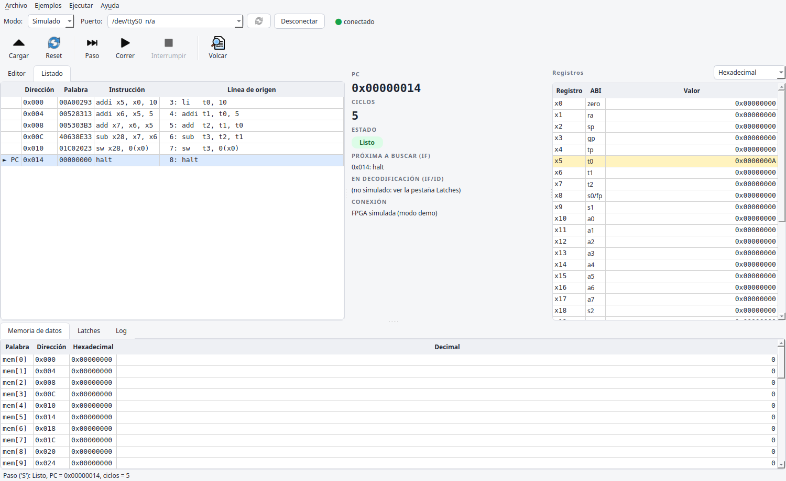
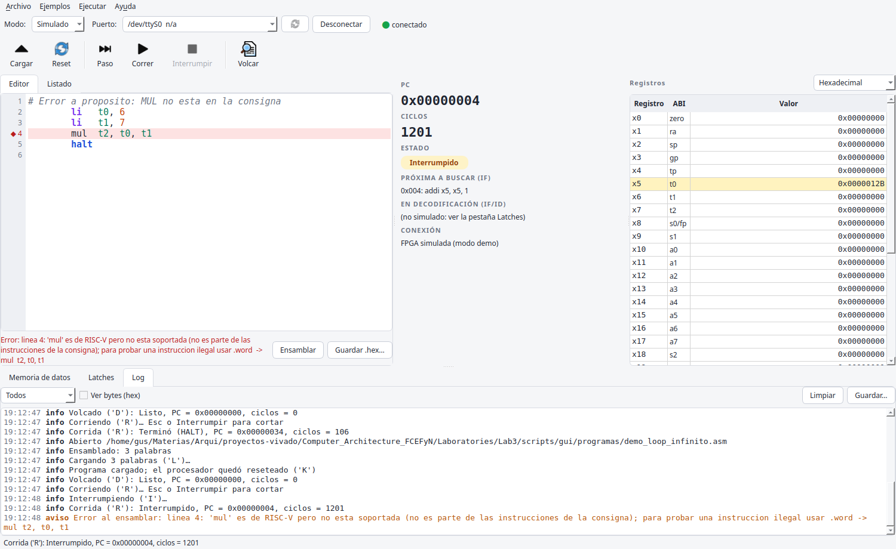
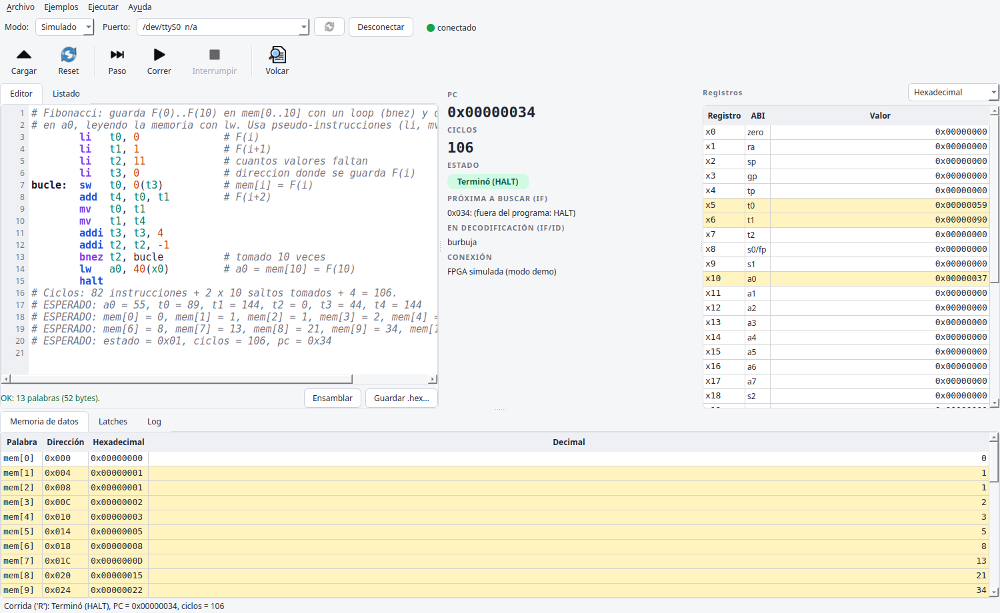
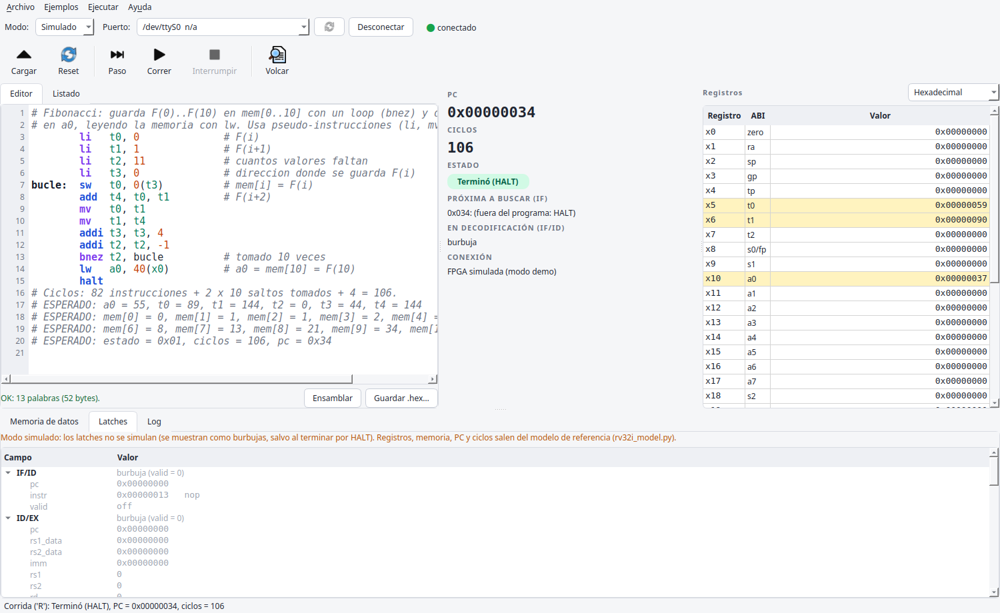
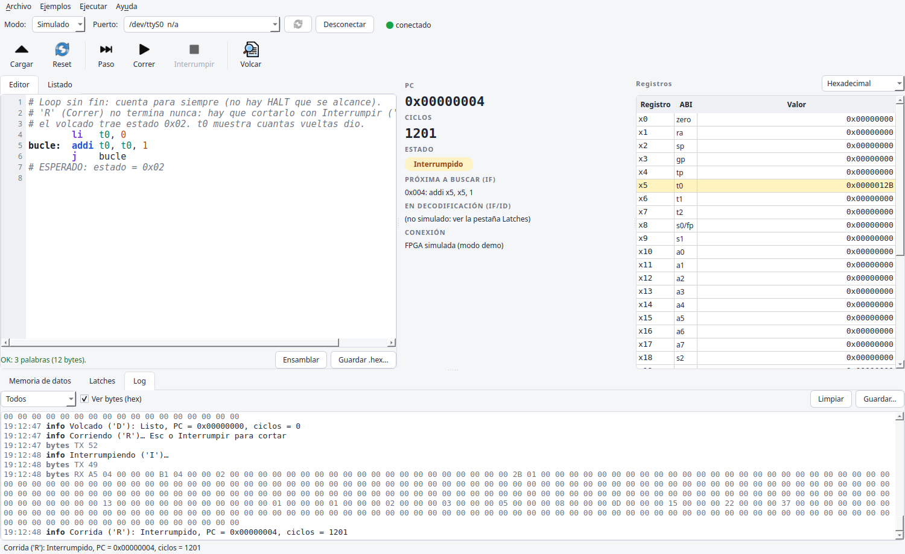

# Manual del depurador gráfico (parte C)

Aplicación de escritorio para cargar programas en el procesador RISC-V de la
Basys 3 y mirar su estado (registros, memoria de datos, latches del pipeline)
sin usar la consola. También funciona **sin placa**, en modo simulado.

El código está en `scripts/gui/`. La herramienta de consola
`scripts/uart_test.py` sigue existiendo y funciona igual que antes.

---

## 1. Instalación (Linux Mint 22, una sola vez)

Todo se corre desde la carpeta `Laboratories/Lab3`.

1. **Python y el entorno virtual** (Mint 22 trae Python 3.12):

   ```bash
   sudo apt install python3-venv
   python3 -m venv scripts/gui/.venv
   scripts/gui/.venv/bin/python -m pip install -r scripts/gui/requirements.txt
   ```

   Instala PySide6 (Qt 6), pyserial, pytest y pytest-qt. Es la única vez que
   hace falta internet: después la aplicación no usa la red.

2. **Paquete de Qt para X11.** El plugin `xcb` de Qt necesita
   `libxcb-cursor0`. Si al abrir aparece *"Could not load the Qt platform
   plugin xcb"*:

   ```bash
   sudo apt install libxcb-cursor0
   ```

3. **Permiso para el puerto serie** (si `groups | grep dialout` no muestra
   nada):

   ```bash
   sudo usermod -aG dialout $USER     # después cerrar sesión y volver a entrar
   ```

4. **Lanzador en el menú** (para abrir con doble clic, sin terminal):

   ```bash
   bash scripts/gui/instalar_lanzador.sh
   ```

   Aparece "Depurador TP RISC-V" en el menú de Mint (Programación) y un
   icono en el escritorio. Si el icono del escritorio aparece con un signo de
   pregunta: clic derecho → *Permitir ejecutar*.

Para abrirla desde una terminal: `bash scripts/gui/lanzar_depurador.sh`.

## 2. Recorrido por la ventana



| Zona | Qué hay |
|---|---|
| Barra de conexión | **Modo** (Placa / Simulado), **Puerto** (★ = el que parece la Basys 3), botón de actualizar, **Conectar** y el indicador (desconectado / conectado / corriendo) |
| Barra de ejecución | **Cargar** (`L`), **Reset** (`X`), **Paso** (`S`), **Correr** (`R`), **Interrumpir** (`I`) y **Volcar** (`D`) |
| Izquierda | **Editor** de ensamblador y **Listado** del programa (dirección, palabra, instrucción desensamblada, línea de origen). La fila del PC se marca con **► PC** |
| Centro | **PC**, **ciclos** y el **estado** con un chip de color: Listo, Corriendo, Terminó (HALT), Interrumpido o Error. Debajo, la instrucción que va a buscar IF y la que está en IF/ID |
| Derecha | **Registros** x0…x31 con su nombre ABI (zero, ra, sp…). El selector cambia entre hexadecimal, decimal con signo y sin signo. Los registros que cambiaron desde el volcado anterior quedan en **amarillo** |
| Abajo | **Memoria de datos** (32 palabras, dirección de byte, hex y decimal, cambios en amarillo), **Latches** y **Log** |
| Barra de estado | El resultado del último comando |

Cada botón se habilita solo cuando tiene sentido: sin conexión no se puede
ejecutar nada; durante una corrida solo está activo **Interrumpir**.

### Conectar

1. Elegir el **modo**:
   - **Placa**: la Basys 3 por USB. La placa aparece como **dos** puertos
     FTDI (uno es el JTAG); el depurador marca con ★ el de la UART. Si no
     aparece, conectar la placa y apretar el botón de actualizar.
   - **Simulado**: una FPGA "de mentira" (`fpga_simulada.py`) que habla el
     mismo protocolo, byte por byte, y calcula el procesador con el modelo de
     referencia. Sirve para practicar o para presentar si falla el hardware.
2. **Conectar**. El depurador pide un volcado (`D`) y muestra el estado.

El último puerto y el modo se recuerdan para la próxima vez. Si se
desenchufa el cable, aparece un aviso, los botones se deshabilitan y la
aplicación sigue respondiendo; para seguir, conectar de nuevo.

### Escribir y cargar un programa

- **Archivo → Abrir…** (`Ctrl+O`): un `.asm`, o un `.hex`, que se muestra
  desensamblado.
- **Ejemplos**: los programas de `scripts/gui/programas/` (demostraciones) y
  los de `scripts/programas/` (pruebas de la integración).
- **Ensamblar** (`Ctrl+B`): arma el listado. Si hay un error, la línea se
  pinta de rojo con un ◆ y el mensaje dice qué pasa:

  

- **Cargar** (`Ctrl+L`): ensambla y manda el programa con `'L'`. La FPGA
  resetea el procesador: registros en 0, PC = 0. **La memoria de datos NO se
  borra** (es RAM): cada programa tiene que inicializar los datos que usa.
- **Guardar .hex…**: el formato que lee `uart_test.py` (una palabra por
  línea, con la instrucción como comentario).

El ensamblador acepta las instrucciones de la consigna, `halt`, etiquetas,
comentarios con `#` y estas pseudo-instrucciones (el listado muestra en qué
se traduce cada una):

| Pseudo | Se traduce a |
|---|---|
| `nop` | `addi x0, x0, 0` |
| `mv rd, rs` | `addi rd, rs, 0` |
| `li rd, valor` | `addi rd, x0, valor` (12 bits), o `lui` + `addi` |
| `j etiqueta` | `jal x0, etiqueta` |
| `call etiqueta` / `ret` | `jal ra, etiqueta` / `jalr x0, 0(ra)` |
| `beqz rs, et` / `bnez rs, et` | `beq rs, x0, et` / `bne rs, x0, et` |

### Ejecutar

| Botón | Tecla | Qué hace |
|---|---|---|
| Paso | `F10` | Un ciclo de clock (`'S'`) y el volcado. Cada paso baja una etapa todas las instrucciones del pipeline |
| Correr | `F5` | Corre hasta el HALT (`'R'`) |
| Interrumpir | `Esc` | Corta una corrida (`'I'`): para un programa sin fin |
| Volcar | `Ctrl+D` | Trae el estado sin ejecutar (`'D'`) |
| Reset | `Ctrl+Shift+R` | Reset del procesador (`'X'`): el programa y la memoria de datos se conservan |



Al cerrar la ventana durante una corrida se manda `'I'` antes de salir: la
placa nunca queda en RUN.

### Latches



Un árbol con los 4 latches (IF/ID, ID/EX, EX/MEM, MEM/WB) y cada campo de la
tabla de `src/params.vh` (sección 4b):

- Las señales de control de 1 bit se ven como **ON** (verde) / **off** (gris).
- Los valores de 32 bits, en hexadecimal; la instrucción, además,
  desensamblada.
- Un latch con `valid = 0` dice **burbuja**.
- Al pasar el mouse por un campo, un tooltip explica qué es.

En **modo simulado** los latches no se simulan: se muestran como burbujas,
salvo al terminar por HALT. El aviso naranja lo recuerda.

### Log



- Hora, nivel (**info**, **aviso**, **error**) y mensaje, con colores.
- **Filtro** por nivel, **Limpiar** y **Guardar…**.
- **Ver bytes (hex)**: muestra cada byte enviado (`TX`) y recibido (`RX`).
- Todo queda también en `~/.local/state/tp_riscv/depurador.log`.
- Cualquier error inesperado va al log y a un cuadro de diálogo, nunca a la
  consola.

## 3. Programas de ejemplo (menú Ejemplos)

| Programa | Qué muestra | Resultado (estado, ciclos, PC) |
|---|---|---|
| `fibonacci` | loop con `bnez`, `sw`/`lw` | 0x01, 106, 0x34 — a0 = 55, mem[0..10] = F(0)..F(10) |
| `suma_arreglo` | arreglo en memoria, load-use en cada vuelta | 0x01, 127, 0x48 — a0 = 108 |
| `demo_forwarding` | dependencias sin esperar | 0x01, 9, 0x18 |
| `demo_load_use` | 1 ciclo de stall (el PC se repite en el paso a paso) | 0x01, 12, 0x20 |
| `demo_flush` | salto tomado: 2 instrucciones descartadas | 0x01, 13, 0x28 |
| `demo_error_ilegal` | `mul` (no soportada) escrita con `.word` | **0x05**, 5, 0x08 |
| `demo_error_memoria` | `lw` fuera de los 128 bytes | **0x05**, 6, 0x14 |
| `demo_loop_infinito` | cuenta para siempre: cortar con Interrumpir | **0x02** |

Cada `.asm` tiene el resultado esperado en líneas `# ESPERADO:`, calculado a
mano. `python3 scripts/gui/generar_programas.py` lo verifica contra el modelo
y genera los `.hex`.

## 4. Tests

```bash
bash scripts/gui/correr_tests.sh
```

Corre todos los tests de Python (unos 35 s):

| Archivo | Qué prueba |
|---|---|
| `test_constantes.py` | Tamaño, offsets, comandos y tabla de latches iguales a `src/params.vh` y a `uart_test.py` |
| `test_decodificador.py` | Volcado → campos con nombre, bits de estado, errores de formato |
| `test_protocolo.py` | Bytes exactos del `'L'`; carga, paso, corrida, interrupción y errores (sin respuesta, timeout, cabecera mala, cable desconectado) contra la FPGA simulada |
| `test_ensamblador.py` | Tabla RV32I, pseudo-instrucciones y errores con número de línea |
| `test_desensamblador.py` | Ida y vuelta (ejemplos y 600 instrucciones al azar) |
| `test_programas.py` | Los ejemplos: anotaciones contra el modelo y `.hex` al día |
| `test_captura_rtl.py` | Volcados **reales** del top simulado con Icarus Verilog (`tests/hdl/tb_captura.v`), decodificados campo por campo, incluidos los 480 bits de latches. Se saltea si no está `iverilog` |
| `test_gui.py` | La interfaz sin pantalla (pytest-qt): conexión, carga, pasos, corrida, interrupción, botones, errores, log |

Las capturas de este manual (en `docs/informe/img/`) se regeneran con:

```bash
QT_QPA_PLATFORM=offscreen scripts/gui/.venv/bin/python scripts/gui/capturas.py
```

## 5. Problemas comunes

| Síntoma | Qué hacer |
|---|---|
| No aparece ningún puerto | Conectar la placa (cable de datos), apretar el botón de actualizar. `ls /dev/ttyUSB*` tiene que mostrar dos |
| "Permission denied" al conectar | Grupo `dialout` (sección 1) |
| "la FPGA no respondió" | ¿Está programada la placa con el bitstream? ¿Es el puerto ★? Probar el otro |
| Se abre y se cierra sin ventana | Correr `bash scripts/gui/lanzar_depurador.sh` en una terminal para ver el mensaje; casi siempre falta `libxcb-cursor0` o el entorno virtual |
| Los resultados no coinciden con la tabla | ¿El programa lee memoria que no inicializó? La memoria de datos conserva lo del programa anterior |
